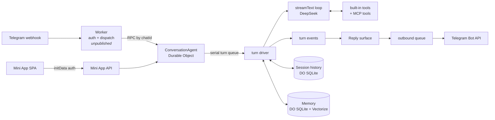

# Architecture

How the published AI modules fit together. The decisions behind each part are in
the [ADR index](adr/README.md); this page describes the shape and the current
limits, and links to code rather than repeating it. Modules marked *unpublished*
exist in the private bot but are not in this repository.

## Request flow

1. The Worker verifies the webhook and forwards the update to the chat's
   `ConversationAgent` ([ADR-0006](adr/0006-conversation-agent-durable-object.md)).
2. The agent enqueues a turn on the Agents SDK's persisted serial queue
   (`maxAttempts: 1`). Chat messages, scheduled turns, approvals and deep-task
   reports all share this queue.
3. The [turn driver](../src/features/agent/turn-driver.ts) reads history, adds
   recalled memory to the user message, assembles tools and runs the
   [agentic loop](../src/features/ai/agentic.ts)
   ([ADR-0047](adr/0047-deepen-the-conversation-agent.md)).
4. [Turn events](../src/features/agent/turn-events.ts) drive the
   [Reply surface](../src/features/agent/reply-surface.ts), which streams Rich
   Message drafts and sends the final transcript through the
   [outbound queue](../src/features/agent/outbound-queue.ts)
   ([ADR-0012](adr/0012-reply-surface-delivery-seam.md),
   [ADR-0021](adr/0021-transcript-reply-multi-message-agentic-turn.md)).
5. The flattened [transcript](../src/features/agent/transcript.ts) is appended to
   Session history, which is compacted past the chat's threshold
   ([ADR-0017](adr/0017-conversation-history-on-agents-session-api.md)).

## Module map

| Area | Code | Decisions |
| --- | --- | --- |
| Durable Object, queue, alarms, fibers | [`conversation-agent.ts`](../src/features/agent/conversation-agent.ts) | [0006](adr/0006-conversation-agent-durable-object.md), [0047](adr/0047-deepen-the-conversation-agent.md) |
| Turn orchestration | [`turn-driver.ts`](../src/features/agent/turn-driver.ts), [`turn-events.ts`](../src/features/agent/turn-events.ts) | [0047](adr/0047-deepen-the-conversation-agent.md), [0021](adr/0021-transcript-reply-multi-message-agentic-turn.md) |
| Model and loop | [`src/features/ai/`](../src/features/ai/) | [0008](adr/0008-agentic-chat-on-vercel-ai-sdk-with-mcp-client.md), [0041](adr/0041-unify-ai-frameworks-on-ai-sdk.md), [0050](adr/0050-use-deepseek-official-api.md) |
| Telegram delivery | [`reply-surface.ts`](../src/features/agent/reply-surface.ts), [`transcript.ts`](../src/features/agent/transcript.ts), [`outbound-queue.ts`](../src/features/agent/outbound-queue.ts) | [0010](adr/0010-rich-messages-for-the-streaming-reply.md), [0012](adr/0012-reply-surface-delivery-seam.md), [0021](adr/0021-transcript-reply-multi-message-agentic-turn.md), [0026](adr/0026-enriched-tool-line.md) |
| Built-in tools | [`tools/`](../src/features/agent/tools/) | [0015](adr/0015-builtin-agent-tools-and-long-term-memory.md), [0019](adr/0019-sandbox-code-interpreter-tool.md), [0022](adr/0022-web-search-and-weather-tools.md) |
| MCP client | [`src/features/mcp/`](../src/features/mcp/) | [0008](adr/0008-agentic-chat-on-vercel-ai-sdk-with-mcp-client.md) |
| Tool approval | [`tool-approvals.ts`](../src/features/agent/tool-approvals.ts) | [0039](adr/0039-tool-approval-as-turn-boundary.md) |
| Scheduled turns | [`scheduled-turns.ts`](../src/features/agent/scheduled-turns.ts) | [0028](adr/0028-scheduled-turns.md) |
| Deep tasks | [`deep-tasks.ts`](../src/features/agent/deep-tasks.ts) | [0040](adr/0040-deep-task-runfiber-in-do.md) |
| Memory | [`src/features/memory/`](../src/features/memory/) | [0015](adr/0015-builtin-agent-tools-and-long-term-memory.md), [0038](adr/0038-layered-memory-auto-recall-and-fact-extraction.md) |
| Stores and settings | [`stores/`](../src/features/agent/stores/), [`chat-settings.ts`](../src/features/agent/chat-settings.ts) | [0047](adr/0047-deepen-the-conversation-agent.md) |
| Debug traces, usage | [`debug-trace.ts`](../src/features/agent/debug-trace.ts), [`usage-ledger.ts`](../src/features/agent/usage-ledger.ts) | [0011](adr/0011-debug-mode-emits-a-json-trace.md), [0041](adr/0041-unify-ai-frameworks-on-ai-sdk.md) |
| Email triage | [`src/ai/email.ts`](../src/ai/email.ts) | [0041](adr/0041-unify-ai-frameworks-on-ai-sdk.md) |
| Mini App API | [`src/features/miniapp/`](../src/features/miniapp/) | [0035](adr/0035-email-listing-and-miniapp-preview.md), [0036](adr/0036-settings-mini-app-frontend-spa.md) |
| Mini App SPA | [`webapp/`](../webapp/) | [0036](adr/0036-settings-mini-app-frontend-spa.md) |

## Models and tools

All language-model calls use `deepseek-flash` at `https://api.deepseek.com`
through `@ai-sdk/openai-compatible` ([`model.ts`](../src/features/ai/model.ts)).
A chat turn runs at most 5 tool steps (`MAX_STEPS` in
[`agentic.ts`](../src/features/ai/agentic.ts)). Workers AI is used only for
embeddings (`@cf/baai/bge-m3`) and document conversion (`toMarkdown`).

Built-in tools are assembled in [`tools/index.ts`](../src/features/agent/tools/index.ts).
Some are registered only when their capability or configuration is present
(for example `web_search` needs `TAVILY_API_KEY`).

**HTML to Markdown parsers.** `fetch_url` first requests `Accept: text/markdown`
and passes Markdown responses through unchanged. Otherwise it converts the HTML
with the parser selected in the chat's settings (`html_parser`):

- `turndown` (default): deterministic, free and fast.
- `ai`: Workers AI `toMarkdown`. Slower and billed, but can handle unusual HTML
  and keeps tables.

Output is capped at 12,000 characters. Email triage has the same two parsers,
chosen in the global service config. There, `ai` falls back to turndown on any
error and the text is capped at 24,000 characters
([`email.ts`](../src/ai/email.ts), [`html-to-markdown.ts`](../src/utils/html-to-markdown.ts)).

## Memory and assets

**Attachments** ([`telegram-attachment.ts`](../src/features/agent/telegram-attachment.ts)):

- Accepted types: JPEG/PNG/WebP/GIF images, PDF, DOCX, XLSX, ODT, ODS, HTML,
  XML, and UTF-8 TXT, Markdown, CSV and JSON.
- Files over 10 MiB are refused.
- Images become native file parts in the model input and in Session history.
- Other documents are converted to text (Workers AI `toMarkdown` for non-text
  types), wrapped as untrusted reference material, and refused above 40,000
  characters.

**History** ([ADR-0017](adr/0017-conversation-history-on-agents-session-api.md)):
the driver reads a 16 MiB recent window from Session. Compaction runs once the
estimated history passes the chat's threshold (default 24,000 tokens,
configurable in chat settings). Each compaction summary also feeds fact
extraction.

**Long-term memory** ([ADR-0038](adr/0038-layered-memory-auto-recall-and-fact-extraction.md),
[`memory.ts`](../src/features/memory/memory.ts)): facts live in DO SQLite and
are indexed in Vectorize (1024-dimension cosine, filtered by `chatId`).

| Constant | Value |
| --- | --- |
| Dedup similarity | 0.85 |
| Confirmations to promote Working → Knowledge | 3 |
| Working-fact decay | 30 days |
| Auto-recall minimum score | 0.55 |
| Auto-recall minimum query length | 6 characters |
| Auto-recall top-k (per-chat setting) | 5 by default |

Saved assets (bookmarks, documents) belong to an unpublished asset service.
Only the shared [asset types](../src/features/assets/types.ts) are included.

## Limits at a glance

| Limit | Value | Where |
| --- | --- | --- |
| Output tokens: chat turn / other calls | 2,048 / 1,024 | [`model.ts`](../src/features/ai/model.ts) |
| Rich Message characters | 32,768 | [`reply-surface.ts`](../src/features/agent/reply-surface.ts) |
| Plain `sendMessage` characters | 4,096 | [`conversation-agent.ts`](../src/features/agent/conversation-agent.ts) |
| Sandbox budget per user, chat and UTC day | 120 s (`SANDBOX_DAILY_LIMIT_SECONDS`) | [`sandbox-usage.ts`](../src/features/agent/sandbox-usage.ts) |
| Active scheduled turns / minimum recurrence | 10 / 15 min | [`scheduled-turns.ts`](../src/features/agent/scheduled-turns.ts) |
| Deep task steps / wall clock | 20 / 15 min | [`deep-tasks.ts`](../src/features/agent/deep-tasks.ts) |
| Pending approval TTL | 1 hour | [`tool-approvals.ts`](../src/features/agent/tool-approvals.ts) |

## Testing

Suites under [`src/tests/`](../src/tests/) run on Node with fakes: a fake model,
a recording reply surface, and injected fetch, clock and stores. They don't
exercise the real Durable Object or Session lifecycle. Several suites import
unpublished modules and fail to load in this repository; see the
[README](../README.md#build-and-test).
