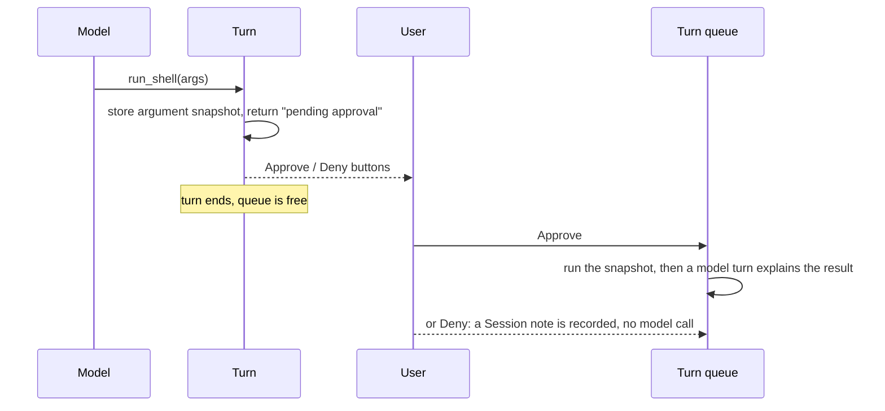

# Code execution and tool approval

`run_code` and `run_shell` run model-written code in a Cloudflare Sandbox
container keyed by chat. `run_shell` runs only after a person approves it in
Telegram.

## How it works

### Sandbox

- `run_code` executes Python, JavaScript or TypeScript through the
  interpreter. Variables and files persist across calls in the same chat, per
  language.
- `run_shell` runs bash and returns stdout, stderr and the exit code. The
  working directory and installed packages persist.
- The container uses the published `-python` Sandbox image, version-matched
  to the `@cloudflare/sandbox` package. State lasts only while the container
  is alive; idle shutdown clears it.
- Tools return text. Generated files and plots aren't uploaded to Telegram.

### Daily budget

Code and shell calls share a wall-clock budget **per user, per chat, per UTC
day**. In a group, each member has their own budget.

- A call is refused once the budget is used up.
- Time is charged even when the call fails.
- The check happens before a call starts; it doesn't stop a call that is
  already running.

### Tool approval

- Only the person who started the call, or an admin, can decide. An
  admin's own calls still need approval, which confirms intent.
- Each pending call has its own row, so a later call doesn't invalidate
  buttons that are already visible.
- Requests expire after 1 hour. `/clear` invalidates them.
- Authorization is checked before revealing whether a request exists.

## Configuration

| Name | Purpose |
| --- | --- |
| `Sandbox` | Durable Object binding for the container |
| `SANDBOX_DAILY_LIMIT_SECONDS` | Daily budget in seconds (default 120; `0` disables it) |

`/usage` reports how much of the budget is used.

## Design decisions

- **A sandbox, not the Worker.** Model-written code never runs inside the
  Worker. A per-chat container lets multi-step work reuse state and installed
  packages ([ADR-0019](../adr/0019-sandbox-code-interpreter-tool.md)).
- **The published image.** Referencing it directly avoids maintaining a
  custom image or Dockerfile. The cost is that installing packages at runtime
  is slower and needs the network.
- **Approval ends the turn.** Suspending a stream while waiting for a person
  would block the chat for hours and need durable recovery. Ending the turn
  frees the queue, and the follow-up turn lets the model explain what happened
  ([ADR-0039](../adr/0039-tool-approval-as-turn-boundary.md)).
- **Only shell is gated.** `run_code` relies on its time budget. MCP tools
  aren't approval-wrapped.

## Known limitations

- This adds billable container infrastructure.
- Code and output can appear in admin [debug traces](debugging-and-usage.md).
- Deep tasks exclude `run_shell` because the approval continuation can't run
  inside a fiber.

## Source

- [`run-code.ts`](../../src/features/agent/tools/run-code.ts),
  [`run-shell.ts`](../../src/features/agent/tools/run-shell.ts),
  [`sandbox.ts`](../../src/features/agent/tools/sandbox.ts),
  [`approval.ts`](../../src/features/agent/tools/approval.ts)
- [`sandbox-usage.ts`](../../src/features/agent/sandbox-usage.ts),
  [`tool-approvals.ts`](../../src/features/agent/tool-approvals.ts)
- Tests: `sandbox-usage`, `tool-approvals` in [`src/tests/`](../../src/tests/)
