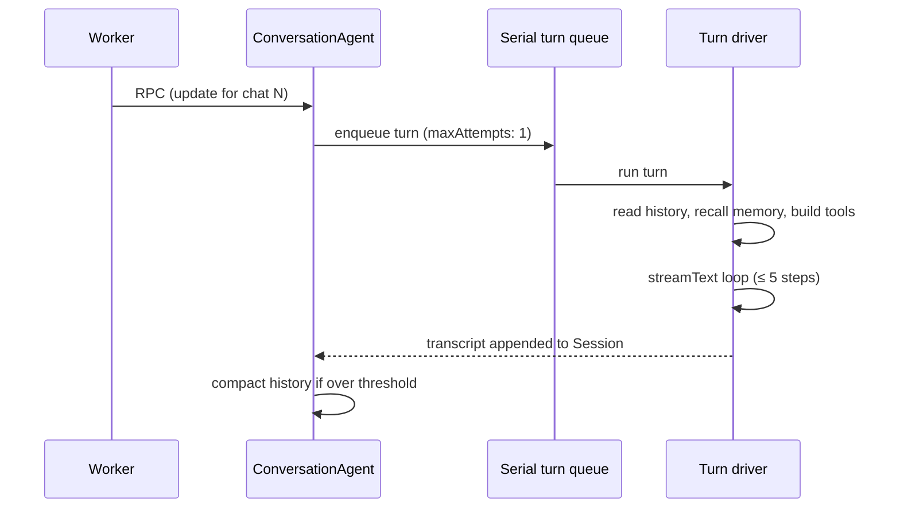

# Conversation agent

Every Telegram chat has one `ConversationAgent`, a Cloudflare Durable Object
built on the Agents SDK. It owns the chat's history, settings, queues, alarms
and background work, and runs every model turn for that chat.

## How it works

1. The Worker authenticates the webhook and forwards the update over RPC to
   the agent addressed by `String(chatId)`.
2. The agent puts a turn on the Agents SDK's **persisted serial queue**. Chat
   messages, scheduled turns, approved tool calls and deep-task reports all
   use this one queue, so history is never written concurrently.
3. The [turn driver](../../src/features/agent/turn-driver.ts) builds the model
   input: the frozen system prefix, a recent history window, recalled memories
   on the user message, and the tool set the sender is allowed to use.
4. The [agentic loop](../../src/features/ai/agentic.ts) streams the reply
   through the [Reply surface](telegram-replies.md).
5. The flattened transcript is appended to Session history, and history is
   compacted once it passes the chat's threshold.

### History

History is stored with the Agents SDK **Session API** in the Durable Object's
SQLite:

- History is append-only and linear. It holds the user's content and the
  assistant's transcript, including compact tool summaries. Raw tool
  arguments and results go only to [debug traces](debugging-and-usage.md).
- The driver reads a recent window of up to 16 MiB.
- The system prefix is frozen from context providers so it stays
  byte-stable. Volatile content, such as recalled facts and the language
  preference, is added to the user message instead.
- Compaction streams history text into a summarizer without carrying image
  payloads, then writes native Session overlays. It does not delete history.
  Each summary is also passed to [fact extraction](memory.md).

### Attachments

Photos and documents are read inside the turn queue
([`telegram-attachment.ts`](../../src/features/agent/telegram-attachment.ts)):

| Input | Handling |
| --- | --- |
| JPEG, PNG, WebP, GIF | Native image part in model input and history |
| TXT, Markdown, CSV, JSON | Decoded as UTF-8 |
| PDF, DOCX, XLSX, ODT, ODS, HTML, XML | Converted with Workers AI `toMarkdown` |

Extracted text is wrapped as untrusted reference material. An attachment
without a caption is summarized by default.

## Usage

| Command | Effect |
| --- | --- |
| `/clear` | Clears conversation history, attachments and pending approvals. Long-term memory is kept. |
| `/forget` | Deletes long-term memory (see [Memory](memory.md)). |

Chat settings (reasoning effort, compaction threshold, memory top-k, language,
HTML parser) are edited in the [Mini App](mini-app.md).

## Limits

| Limit | Value |
| --- | --- |
| Tool steps per turn | 5 |
| Attachment size | 10 MiB |
| Extracted document text | 40,000 characters |
| History read window | 16 MiB |
| Compaction threshold | 24,000 estimated tokens (per-chat setting) |

## Design decisions

- **One Durable Object per chat.** Keeping history and execution together
  avoids the lost updates of a shared KV history under concurrent webhooks
  ([ADR-0006](../adr/0006-conversation-agent-durable-object.md)).
- **An explicit serial queue.** Durable Object identity alone doesn't order
  turns. The persisted queue does.
- **`maxAttempts: 1`.** Replaying a turn could repeat tool side effects, so a
  failed turn isn't retried.
- **Session API for history.** One store in the Durable Object instead of a
  second shared history store and custom retention code
  ([ADR-0017](../adr/0017-conversation-history-on-agents-session-api.md)).
- **Lifecycle and orchestration are separate.** The agent owns RPC, the queue,
  alarms, fibers, Session and dependency assembly. The turn driver takes
  explicit dependencies, and store adapters own table access. This lets the
  main turn run under Node with fakes
  ([ADR-0047](../adr/0047-deepen-the-conversation-agent.md)).

## Known limitations

- The Session API is experimental; check the installed `agents` version when
  changing the integration.
- Node tests use fakes and don't exercise the Durable Object lifecycle or
  Session storage.

## Source

- [`conversation-agent.ts`](../../src/features/agent/conversation-agent.ts):
  the Durable Object
- [`turn-driver.ts`](../../src/features/agent/turn-driver.ts): per-turn
  orchestration
- [`chat-settings.ts`](../../src/features/agent/chat-settings.ts): typed
  settings and defaults
- [`stores/`](../../src/features/agent/stores/): SQLite stores (Drizzle) and
  schema bootstrap
- [`session-compaction.ts`](../../src/features/ai/session-compaction.ts),
  [`session-messages.ts`](../../src/features/ai/session-messages.ts)
- Tests: `turn-driver`, `session-compaction`, `session-messages`,
  `telegram-attachment` in [`src/tests/`](../../src/tests/)
