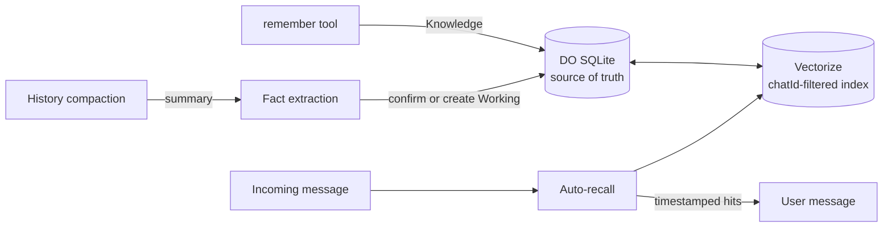

# Memory

Long-term memory stores facts about a chat and recalls them in later turns.
Facts come from the `remember` tool and from automatic extraction during
history compaction. Relevant facts are added to each incoming message.

## How it works

### Two layers, one store

Every fact has a **layer**, which is a lifecycle state rather than a separate
store:

| Layer | How a fact gets there | Expires |
| --- | --- | --- |
| **Working** | Created by fact extraction | Pruned when not seen for 30 days |
| **Knowledge** | Explicit `remember`, or a Working fact confirmed 3 times | Never, automatically |

- Extraction runs on each compaction summary. A new fact that is similar
  enough to an existing one (similarity at least 0.85) confirms it instead of
  creating a duplicate. Updated wording keeps the fact's ID and confirmation
  count and replaces its text and vector.
- Promotion only changes metadata; nothing is copied between stores.
- Each fact records its source (`explicit` or `extracted`), confirmation
  count and last-seen time.

### Auto-recall

For each message of at least 6 characters, both layers are searched in
Vectorize, filtered by `chatId`. Hits scoring at least 0.55 are added, with
timestamps, to the incoming user message, not the stable system prompt. The
`recall` tool is still available for deliberate searches. Debug traces show
the hits.

## Usage

| Surface | Action |
| --- | --- |
| `remember` / `recall` tools | Save or search facts in conversation |
| `/forget` | Deletes all facts from SQLite and Vectorize |
| `/clear` | Clears conversation state only; memory is kept |
| Mini App → Memory tab | Lists facts by layer with dates and confirmation counts; *Forget all* asks for confirmation first |

Group-chat memory is managed from inside the group.

## Configuration

| Setting | Default | Where |
| --- | --- | --- |
| Auto-recall top-k | 5 | Mini App chat settings |
| `MEMORIES` binding | none | Vectorize index: 1024 dimensions, cosine, `chatId` metadata index |
| Embedding model | `@cf/baai/bge-m3` | Code constant (multilingual, Chinese and English) |

Changing the embedding model requires a new index and re-embedding every
fact, not just a model-name change.

## Design decisions

- **SQLite is the source of truth; Vectorize is the index.** SQLite is also
  needed to list vector IDs for deletion
  ([ADR-0015](../adr/0015-builtin-agent-tools-and-long-term-memory.md)).
- **Automatic memory.** With only the tools, facts were rarely written or
  recalled. The cost is one embedding per eligible turn and one extraction
  call per compaction
  ([ADR-0038](../adr/0038-layered-memory-auto-recall-and-fact-extraction.md)).
- **Reuse the compaction summary.** There's no second summarizer.
- **Recalled facts go on the user message** so the system prefix stays
  cacheable.
- **No charts or relationship graph** in the Mini App: they don't help when
  inspecting facts.

## Known limitations

- Vectorize is eventually consistent. A fact may not be found immediately
  after it's saved, and rapid extraction can create duplicates.
- Contradicting facts that aren't similar aren't resolved automatically.
- Extraction doesn't create saved assets; those belong to the separate,
  unpublished asset service.

## Source

- [`memory.ts`](../../src/features/memory/memory.ts): the module and its
  thresholds
- [`extraction.ts`](../../src/features/memory/extraction.ts): fact extraction
- [`memory-tools.ts`](../../src/features/agent/tools/memory-tools.ts),
  [`stores/memory-store.ts`](../../src/features/agent/stores/memory-store.ts)
- Tests: `memory` in [`src/tests/`](../../src/tests/)
