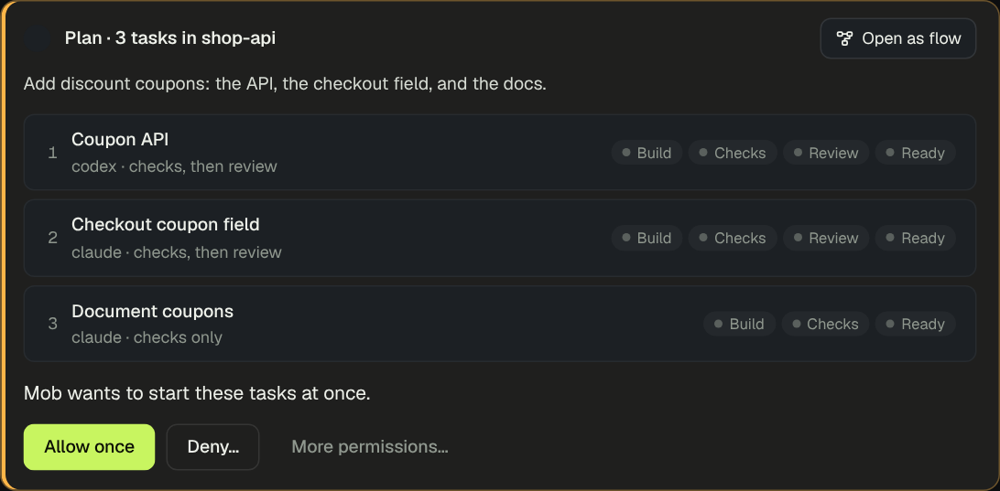
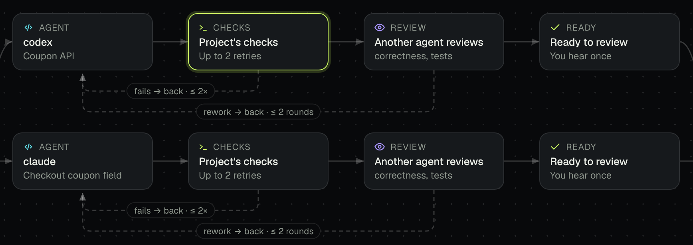
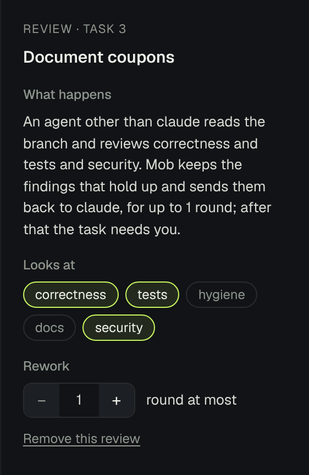
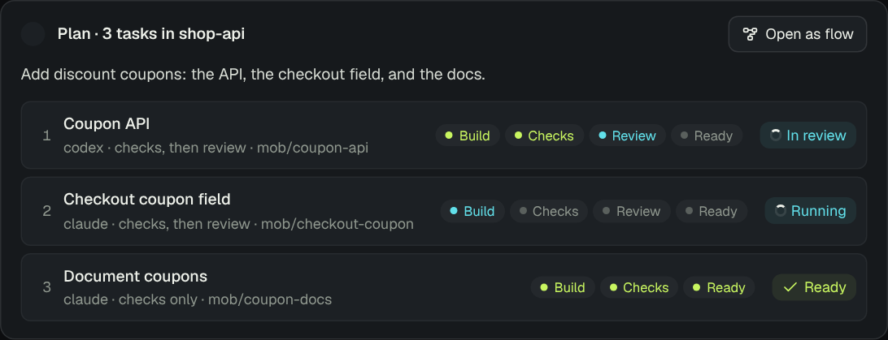

# Plans

When work splits into parts that can go on at the same time, Mob proposes
them as one **plan**: up to six coding tasks in one project, each for its own
agent in its own worktree and branch. You approve the plan once, and every
task starts.

<!-- prototype: /prototype/plan/ -->

Each row is one task: its title, its agent, what its
[blueprint](task-workflow.md#blueprints) runs after the agent's work, and
those steps as small pills (Build › Checks › Review › Ready). Approve it from
the card, or open the flow first.

## See the plan as a flow

**Open as flow**, or click a row, draws the plan as a flowchart. The plan
fans out into one lane per task: the agent builds, the project's checks run,
another agent reviews, and the task is ready. Dashed loops show what goes
back to the agent, and how often: a failing check up to its retries, a
review's findings up to its rounds. Every lane ends with you, and shipping is
always yours: Mob does not push or merge.

<!-- prototype: /prototype/plan/?flow=0.verify -->

Click a step to see what it does. Details stay a click further: a task's
instructions sit under **Instructions**, and a started task's last checks and
the review's conclusion under their own headings.

## Change a plan before you approve it

While the plan waits for you, the step inspector edits the task:

| Step | What you can change |
| --- | --- |
| Agent | the task's instructions |
| Checks | how many times a failing check goes back to the agent (0–3) |
| Review | what it looks at (correctness, tests, hygiene, docs, security), how many rounds (1–3), or remove it |
| Ready | **Add a review before this**, for a task without one |

A changed step gets a dot, and the decision reads **Approve with N changes**;
**Undo changes** puts the plan back as Mob asked. Mob checks your changes as
it checks a blueprint before it starts anything.

<!-- prototype: /prototype/plan/?flow=2.ready -->

A task of the `manual` blueprint leaves checking to Mob's model, so it has
no stages to change. Which agent works on a task cannot be changed here yet.

## Follow a plan

Once approved, each row shows where its task is, and its status opens the
task's conversation. The pills light up as the task moves: done in green,
working in blue, waiting for you in amber.

<!-- prototype: /prototype/plan/?started=6 -->

In the flow, the step a task is on says what is happening, such as
"Round 1" in review or "Fixing what the checks found", and the inspector
opens its conversation.

You hear once per task, when it is **Ready to review** or **needs you** (see
[Blueprints](task-workflow.md#blueprints)).

How it works

**The tool.** `task_plan` (owner only) takes a project, an optional summary,
and one to six tasks, each with a title, a prompt, and optionally an agent and
a blueprint (the project's by default). It asks for one approval, then starts
the tasks in order from the conversation that asked, as `task_start` would. A
task that fails to start is reported and the others go on. The result names
each started task's place in the plan, so the card shows each start against
its own task. Always allow covers plans in the same project with the same
agents and blueprints. The manager prompt has the model propose work that
splits into parts that can go on at once as one plan.

**What the approval holds.** The plan, with each blueprint as a line for
people (`does`) and its stages for the card. Messaging channels show the
tasks one numbered item at a time and one line per blueprint.

**Approving with changes.** An approval may carry a changed input
(`Answer.input`). Only a tool that defines `revise` accepts one: it checks
the change and returns the input to carry out, and the approval and the call
keep what was approved. Other tools refuse a change and the approval keeps
waiting. `task_plan`'s `revise` keeps the project, the tasks and their agents;
it takes each task's `prompt` and `stages` (`null` goes back to the
blueprint's), checks the stages with the blueprint rules (at most 3 retries
and 3 rounds, each stage once, checks before review, known aspects), and
drops stages that are the same as the blueprint's.

**A task's own stages.** A changed task starts with `tasks.flow.stages`, and
Mob runs those in place of its blueprint's (`stagesOf` in
`apps/mob/src/agents/blueprints.ts`).

**Where it lives.** The tool and `revisePlan` are in
`apps/mob/src/agents/tools.ts`; the card, the flow and the inspector in
`packages/app/src/PlanCard.tsx`; approving with changes in
`packages/core/src/chat/conversation.ts` (`revise`) and `store.ts`
(`decide`, `pendingApproval`).

