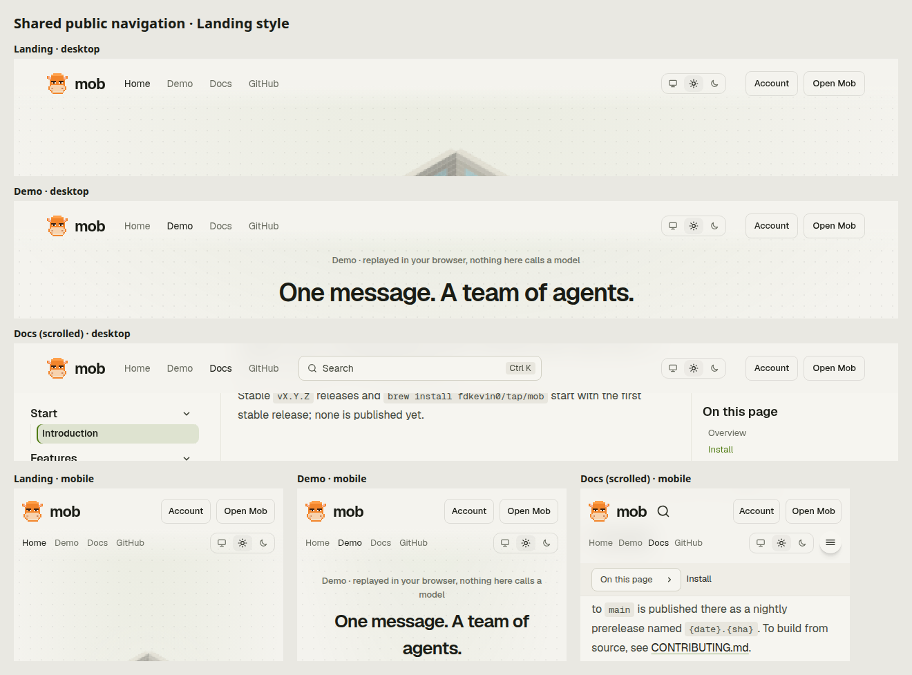

# Remote access (experimental)

Mob runs on the user's machine and serves its clients over loopback.

## Public web UI

The site at https://usemob.app is deployed to Cloudflare Workers, so web
changes reach users when they merge, without a release. It has five parts,
served by the Worker in `worker/`:

The landing, demo, documentation and account pages share Home, Demo, Docs
and GitHub navigation, a theme picker, and fixed Account and Open Mob links.
The current section is marked; on narrow screens the navigation and theme
picker occupy a second row instead of disappearing. Docs keeps search inside
the header, collapsing it to an icon when space is limited; its mobile
documentation menu also stays in the header. Its translucent background blurs
scrolling content behind the navigation. Account opens
account management (or sign-in when signed out); Open Mob opens the app
(or sign-in). Sign out is on the account page. The landing page's Get started
button also opens sign-in directly, with How it works, Features and Install
links beneath it for navigation within the page.

- `/` is the landing page, scrolled through in pages over one pinned isometric
  voxel office. Each load lays out a new square open-plan floor of shared
  desks and seats calves on about 70% of them; every calf comes from one
  template (the 牛来的 face of the logo: flat brows, a staring look, a big pale
  muzzle and pointed ears) with a generated skin. Most sit working at their desks; a few at a
  time walk the lanes to high-five, hand
  each other blocks of work, fetch milk tea or coffee, pin notes on the
  whiteboard, try things in the glass booth, put a hand up for the gold
  leader's nod and nap on the sofa, until the leader comes over and cracks its
  whip. `?office=<seed>` pins a layout. The first page is the title over the
  office; the second plays one task step by step in a chat window while the
  calves involved are lit up; the third moves the office left and lists the
  features, and clicking a calf jumps to the feature its activity stands for.
  With reduced motion the pages stack without animation. It is drawn with
  WebGPU (Canvas 2D where WebGPU is missing). The office and the conversation
  are idealised, not a picture of what Mob does today.
- Links to the site show a preview card in Telegram, Slack, X and other apps:
  the landing page and every docs page carry Open Graph and Twitter card tags
  with the 1200×630 image `webapp/public/og.png` (served at `/og.png`, straight
  from static assets). `/app` and `/account` send visitors without a session,
  crawlers included, to the landing page, so their links preview the same.
  Telegram caches a preview per URL; after changing the image or tags, send
  the link to @WebpageBot to refresh it.
- `/logo.svg` is the transparent brand artwork; `/logo.png` is its 512×512
  rendering with a transparent background. Both and `/og.png` are served
  directly from static assets; pages still pass through the Worker for
  sign-in checks and content security policies. Unknown paths return 404
  instead of redirecting to the landing page.
- Sign-in is GitHub or Cloudflare OAuth through Better Auth, with no
  passwords. Cloudflare is offered once `CLOUDFLARE_CLIENT_SECRET` is set. A
  Cloudflare Turnstile check has to pass before either flow starts. Accounts
  are never linked by matching emails: signing in with Cloudflare under the
  email of an account GitHub made is refused with a hint to sign in with
  GitHub and connect Cloudflare on the account page. Provider tokens are
  stored encrypted with `BETTER_AUTH_SECRET`. Accounts and
  sessions live in the D1 database `mob-auth`, alongside runner ownership and hashed pairing credentials. Conversation content stays on the runner.
- Passkeys are an extra way into an account that GitHub created; they never
  create an account. **Sign in with a passkey** in the sign-in dialog skips
  Turnstile (a passkey cannot be guessed or used to sign up) and opens `/app`.
  A passkey that is not bound to any account is refused with a hint to sign in
  with GitHub first. The relying party ID is the site's hostname, so passkeys
  made on `usemob.app` do not work on preview hostnames or the previous domain.
- `/account` shows the signed-in user, the connected GitHub and Cloudflare
  accounts (either can be connected there, and disconnected while the other
  still signs in) and the account's passkeys, which can be added, renamed and removed. The GitHub row
  shows the current username: the page asks GitHub once per visit with the
  stored OAuth token (Better Auth `account-info`), so a renamed account shows
  its new name, and it only says Connected when GitHub does not answer.
  Browsers do not reveal device names, so a new passkey is named after its
  provider from the authenticator's AAGUID (such as iCloud Keychain, Google
  Password Manager or Windows Hello) and is otherwise called Passkey; Apple
  often reports an anonymous AAGUID. It can be renamed. Visitors without a session go to `/?signin=account` and come back
  to `/account` after signing in. Adding a passkey needs a session less than a
  day old; with an older session the page asks the user to sign in with
  GitHub again. The landing page's account menu and the `/app` runner menu link
  to it. The page has its own entry and a content security policy that allows
  only the site itself.
- `/app` is the web UI. The Worker sends visitors without a session back to
  `/?signin=app`. With no local Mob or runner saved, `/app` runs Mob in the
  browser (see [Mob in the browser](#mob-in-the-browser)), so a signed-in
  visitor can start talking at once. **Connect a runner** in the runner menu
  opens a dialog over the current workspace. The sidebar, selected conversation
  and draft stay in place when it is closed or a connection fails. The browser
  runner remains selected until another runner connects successfully. Choosing
  **This browser** again closes the dialog without reopening the conversation.
  Closing the dialog discards any pending connection result.
  After disconnecting a local or remote runner, the connection screen offers
  the same dialog. Choose **This browser** to reopen the browser workspace. The dialog offers **This browser**, **Your own runner** (paired runners, or the Mob address and access token of
  Mob on this computer), **Deploy to the cloud**, a free runner in the user's
  account at Render or another host (see
  [Runners in the cloud](#runners-in-the-cloud)), and **Cloud runner**, which is
  disabled and marked coming soon. A `mob open --web` link opens the dialog to show its
  progress, and a replaced token reopens it with the reason.
- The browser keeps what each Mob showed last in IndexedDB, separately for
  each runner and local address, so a Mob it has shown before opens at once
  and then catches up; the public web also reopens the runner it last opened.
  Only the conversation list (titles) is kept by default. Messages of the 20
  most recently opened conversations are kept only after **Keep messages on
  this device** is turned on in the runner menu; turning it off forgets them.
  **Disconnect** or a rejected token forgets everything kept for that Mob.
  While Mob is unreachable, the workspace shows what was kept and says so.

- `/docs` is the documentation, built with Starlight from `apps/docs`. Its
  pages are this repository's Markdown (`README.md`, `CONTRIBUTING.md` and
  `docs/`), copied in at build time, so they change when those files merge.
  It needs no sign-in and has local search.

The landing page and workspace share the dark theme, Geist fonts and pixel
logo. The workspace uses calmer, rounded controls in the local browser, the
desktop app and `/app`: one rounded message box holds the text, the model
picker and a round send (or stop) button; replies have no role labels; each
tool call is one line with its status that opens to show input and output,
and a pending approval opens as a card with Approve, Allow in this
conversation, Always allow and Deny (which then asks for an optional reason). On narrow screens, Conversations opens a side panel; choosing
a conversation closes it. Model selection and sign-in dialogs contain keyboard
focus and return it when closed. Plugin tabs support arrow-key navigation and
keep unsaved configuration edits when switching tabs.

The documentation shares the origin, so it runs only scripts its build emitted:
each page carries a policy `<meta>` with hashes of its scripts and styles, and
the Worker adds a header policy that allows only the site itself (plus
WebAssembly for search) and no framing. It loads no third-party scripts,
fonts or embeds; anything that needs them would move the documentation to a
separate origin.

The two pages have separate entries and network policies. Sharing presentation
does not load the landing page's authentication client, Turnstile or voxel scenes
into the workspace.

Pairing with Mob on your computer works as before:

- `mob open --web` asks the running service for a one-time pairing code and
  opens `web_url` with `#offer=` and the base64url JSON
  `{"v":1,"url":"http://127.0.0.1:8787","code":"…"}`. The fragment never reaches
  the site. The landing page holds it in session storage while you sign in;
  GitHub returns to the fixed `/?signin=done`, so the code never reaches
  Better Auth or GitHub. The landing page then removes the code from storage
  and hands it to `/app` once, which exchanges the code at `url` for the access token and keeps the
  address and token in local storage. The code, not the token, travels in the
  link because it expires after 5 minutes and works once.
- Local pairing links accept only `http://127.0.0.1` and `http://localhost`
  addresses. The `/app` content security policy permits those loopback hosts
  and the site itself for encrypted runner access; crafted local links cannot
  point at another server. The landing page may call its own site (sign-in) and
  Turnstile. It shares an origin and the sign-in with `/app`, so the
  Turnstile script, loaded only when the sign-in dialog opens, runs where the
  token is stored.
- `web_url` (`MOB_WEB_URL`) must be https, or http on a loopback host for
  development. Use `--web-url=` or `web_url: ""` to turn this off; an empty
  environment variable is ignored. The service lets that origin call the API
  and answers Chrome's Private Network Access preflight. Whoever controls the
  site's code can read the token of a browser signed in there, so only `main`
  deploys.
- Chrome and Firefox let an https page reach `http://127.0.0.1`; newer Chrome
  asks first. Safari refuses, so use `mob open` there.

Deployment:

- `bun run build:web` builds `webapp/dist-public` (Vite `--mode public`):
  `landing.html` and the web UI's `index.html`, then the documentation into
  `webapp/dist-public/docs`. Hashed documentation assets (`/docs/_astro/`,
  `/docs/pagefind/`) are served without running the Worker. Cloudflare Workers Builds
  deploys `wrangler.jsonc` with build command
  `bun install --frozen-lockfile && bun run build:web` and deploy command
  `npx wrangler d1 migrations apply DB --remote && npx wrangler deploy`.
  The custom domain route serves production at `usemob.app` and, with
  `previews_enabled: true`, previews at `<preview-name>.usemob.app`.
  Deploy production once to apply the domain configuration before creating previews.
- PR builds use deploy command
  `npx wrangler d1 migrations apply DB --remote --config wrangler.preview-migrations.jsonc && npx wrangler preview`.
  This automatically applies pending preview database migrations before deployment;
  a migration failure stops deployment, and applied migrations are skipped.
  Wrangler requires the explicit
  `previews` block in `wrangler.jsonc`: public variables and the `DB` binding
  do not inherit their production values. Previews share the separate
  `mob-auth-preview` database.
  Keep that file's database ID aligned with `previews.d1_databases`.
  Set the auth secrets in Cloudflare's Previews Base configuration;
  production secrets are not inherited. Preview URLs are public unless access
  controls are configured. GitHub OAuth callbacks and Turnstile hostnames must
  also allow the preview hostname to exercise sign-in there, and so must the
  Cloudflare OAuth client's redirect URLs.
- Secrets: `BETTER_AUTH_SECRET`, `TURNSTILE_SECRET_KEY`,
  `GITHUB_CLIENT_SECRET` and `CLOUDFLARE_CLIENT_SECRET`. The public
  `TURNSTILE_SITE_KEY`, `GITHUB_CLIENT_ID` and `CLOUDFLARE_CLIENT_ID` are
  vars in `wrangler.jsonc`. The OAuth callback URLs are
  `https://usemob.app/api/auth/callback/github` and
  `https://usemob.app/api/auth/callback/cloudflare`. Cloudflare always asks
  for `user-details.read`; the `CLOUDFLARE_SCOPES` var (space-separated scope
  IDs as the Cloudflare OAuth client lists them) adds account read, Workers
  AI and `offline_access`, which Workers AI in the browser needs.
- Locally, put the secrets in `.dev.vars`, which overrides the vars too
  (Turnstile's test keys work), run
  `npx wrangler d1 migrations apply DB --local`, `bun run build:web` and
  `npx wrangler dev --port 8799 --local-upstream 127.0.0.1:8799` (the flag
  keeps the request host local instead of the production domain; port 8787 is
  Mob's own). The GitHub OAuth app then needs the local callback URL.

## Encrypted remote runners

A runner lets a signed-in GitHub account control Mob on another computer,
without opening an inbound port on that computer. The web app lists only the
account's runners. Conversations, tools and approvals use the existing local
Mob API; the relay cannot call it without an authenticated encrypted request.

1. Sign in at `/app` and choose **Pair a runner**.
2. On the computer running Mob, run `mob runner pair`. Paste the private JSON
   shown in the browser into stdin and press Enter. Do not put it in shell
   arguments, tickets or messages: it contains the encryption key.
3. Run `mob start` (or keep `mob serve` running), then `mob runner`. Keep the
   runner process running. It actively connects to the site over WebSocket
   and reconnects after a disconnect.
4. When the runner appears online, choose **Open runner** in that browser.
   Use **Revoke access** to invalidate its cloud credential and disconnect it.
   Stopping `mob runner` also stops remote access, without stopping local Mob.

The pairing code expires after five minutes and can be claimed once. The
browser generates a random 256-bit encryption key and retains it locally;
only the one-time pairing code is sent to the cloud. The CLI receives the key
through the pasted JSON, and stores it with the separate runner credential in
`runner.json` in Mob's data directory, with mode `0600`. Its local API token
never leaves the computer. A local token rotation requires restarting
`mob runner` to read the new token. Remote clients cannot mint local pairing
codes, rotate the local token or stop the local service.

Each runner has a Durable Object that forwards opaque envelopes. API methods,
paths, headers, bodies, HTTP statuses and response chunks are encrypted with
AES-256-GCM using random 96-bit nonces. Authenticated associated data binds
protocol version, runner ID, connection session, request ID, direction, chunk
sequence and final-frame status. The runner creates a fresh random session on
every connection, ignores repeated requests, and caps concurrent requests.
A request it refuses (expired, or the runner is busy) gets an encrypted error
saying it did not run; the connection and other requests carry on. Browser
clocks should be synchronized: requests expire after 45 seconds and the runner
rejects expiry times more than a minute in its future. When a browser stops
reading a response, the relay tells the runner to cancel that local request.
A local response that breaks off ends with an authenticated failure, so the
browser rejects it like a reordered, modified or incomplete response. Never
blindly retry a failed action: check saved conversation history first.

The cloud stores account and runner identifiers, hashes of pairing codes and
runner credentials, and timestamps. It can observe connection/IP metadata,
request timing and ciphertext sizes, but has no decryption keys or plaintext
conversation/tool data. HTTP request bodies are limited to 1 MiB before
encryption. A request that produces no output for six minutes fails, at the
relay and at the runner; a longer turn keeps streaming while it produces output. Disconnecting does not undo a completed tool
operation or stop an independently running conversation turn.

Keys belong to the pairing browser. Clearing its site data loses its key;
other browsers must create a new pairing. There is no cloud key recovery,
key synchronization, or forward secrecy after an endpoint key is compromised.
Revoke obsolete runner registrations; an account may have up to 20 pending
or paired runners.

**Trust boundary:** this protects content from the relay and database under
the shipped protocol. The browser still trusts JavaScript served by the site,
including future deployments and same-origin scripts. A malicious deployment
could steal its key before encryption. Protecting against a developer who
changes that JavaScript requires an independently distributed and verified
client; this web version cannot promise that protection. The local model
provider and locally configured tools still receive the data required to do
their work.

The Worker deployment adds the `RUNNERS` Durable Object binding and its SQLite
class migration, plus D1 migration `0002_runners.sql`. Apply the D1 migration
before deploying this Worker; the existing Workers Builds command does so.
No additional cloud secrets are needed. Passkeys add D1 migration
`0003_passkey.sql` (the Better Auth `passkey` table), applied the same way.
`bun run test:runner` runs the real
Worker/D1/Durable Object, the built `mob` binary, runner and browser encryption code
locally with fake account sessions and an offline demo model.

## Mob in the browser

The public web can run Mob's core service, `@mob/core`, in a dedicated Web
Worker in the tab (`webapp/src/chat/browser/`), so no runner is needed. The
page reaches it through a `fetch` that posts each request to the worker and
streams the response back, the same way the relay is a `fetch` for paired
runners; the API, the chat stream and the change feed are unchanged. The
database is the usual SQLite schema on sqlite-wasm, stored in the origin
private file system (OPFS) with the `opfs-sahpool` VFS, and `providers.json`
is a setting in that database. Where OPFS is unavailable, such as in some
private windows, conversations last until the tab closes. One tab at a time
owns the database; another tab says so until it is reloaded after the first
one closes.

The browser runner has what needs no process of its own: conversations,
approvals, memory, commands, token usage and the demo model. Model calls go
straight from the browser to the provider, so they work only with providers
that allow cross-origin requests; OpenCode Zen does not, so the browser
runner starts on the offline demo model. **Model provider** in the runner menu
saves one provider: a preset (OpenAI, Anthropic, OpenRouter and other vendors
that take a key) or a custom OpenAI Chat Completions or Anthropic Messages
base URL, with its API key and optionally a model. Saving lists the
provider's models and makes the named model, or the first listed, the
default (`POST /api/plugins/browser/provider`). An Anthropic-only provider is
sent `anthropic-dangerous-direct-browser-access`. With OpenRouter selected,
**Sign in with OpenRouter** gets a key without copying one: OpenRouter's PKCE
flow returns to `/app?code=…`, and the worker trades the code, with the
verifier kept in the tab's session storage, for a key of the user's account
(`POST /api/plugins/browser/openrouter`), which the user can limit or revoke
on OpenRouter. OpenRouter is the browser's way to free models, so without a
named model it starts on a free model that takes tools (OpenRouter limits
free models per day), and on `openrouter/auto` when none is listed. Mob does
not proxy OpenCode Zen through usemob.app: OpenCode's docs say its free-tier
chat models require OpenCode, so other clients must use its paid models.

**Cloudflare Workers AI (your account)** needs no key: it uses the Cloudflare
account the visitor signed in with or connected on `/account`, which includes
a daily free allowance. The provider's base URL is the site's own
`/api/ai/cloudflare/v1` (`POST /api/plugins/browser/cloudflare`); the Worker
there checks the session and the request's origin, takes the stored token
(refreshing it when it has expired), finds the first account it reaches, and
forwards `GET /models` (Workers AI text generation models, with
`supported_parameters` marking those that take tools) and
`POST /chat/completions` to Workers AI's OpenAI-compatible endpoint. The token
never reaches the page, and without a model named the browser starts on the
first one that takes tools.

**Chrome built-in model (experimental, offline)** is offered where the
browser has Chrome's Prompt API (`LanguageModel`, Chrome 148 or later on a
desktop). It runs Gemini Nano on the device: free, with no key, and offline
once Chrome has downloaded the model (about 4 GB, once; Chrome downloads only
after a click, so the dialog starts the download with a progress bar before
it saves). The Prompt API exists only on pages, not in workers, so the
provider's base URL is `https://built-in.chrome.invalid/v1`, which never
reaches the network: the worker answers it like an OpenAI-compatible server
(`GET /models` lists `gemini-nano`, `POST /chat/completions` streams server-sent
events) and posts each prompt to the page, which creates a session with the
conversation so far and streams the reply back (`POST
/api/plugins/browser/chrome`). Gemini Nano is small and cannot call tools
reliably, so the provider is saved with `tools: false`: it only replies, and
cannot use tools or run tasks. Tool calls and results that another model
made earlier in the conversation reach it as labeled text, so it can still
answer from them. It reads and writes English, Spanish and Japanese best,
and its context is about 6,000 tokens; a prompt Chrome refuses as too long
(`QuotaExceededError`) is retried shorter, like any context overflow.

Keys are stored unencrypted in the browser's database, in the site's origin
private file system, like any key a web app keeps. The browser keeps other
sites out, and the API returns keys only masked, but anyone who can run code
on usemob.app or read the browser profile on disk can read them; the strict
content security policy and having no third-party scripts on the origin are
what guard the first. Coding agents, the sandbox, stdio MCP
servers, messaging channels and schedules need a runner, and Plugins & cloud
services is hidden. Mob stops when the tab closes.

The workspace says so: on first use, and whenever **What needs a runner** in
the runner menu is chosen, a notice lists what works and what needs a runner,
with **Connect a runner** beside it. When OPFS is unavailable it also warns
that conversations end with the tab. The Agents page says coding agents need a
runner instead of listing none.

### Moving conversations

**Move conversations** in the runner menu of the public web copies conversations
to another Mob this browser can reach: this browser's runner, a runner it
paired, or Mob on this computer (when its token is saved here), and offers to
open it afterwards. It takes each conversation's messages, summary, model,
saved facts and token usage; the originals stay. Pending approvals, grants,
tasks and schedules do not move, and a conversation that is still replying or
waits for an approval is refused until it is done. The service side is
`GET /api/conversations/{id}/export` and `POST /api/conversations/import`
(`Transfer` in `packages/client/src/contracts.ts`); an import gets a new
conversation ID, replaces message IDs the target already has, marks a reply
that was still streaming as interrupted and does not save an owner's fact
twice. Through the relay a conversation must fit the relay's frame limit of
about 2 MB.

The worker is built to `/runner/` (not `/assets/`) so the site's Worker can
give it its own content security policy: it may compile WebAssembly and
connect to any HTTPS provider, while the `/app` page that holds access tokens
keeps its narrow `connect-src`. The local web UI that Mob serves itself is
built without the browser runner.

## Runners in the cloud

**Deploy to the cloud** in the Connect a runner dialog runs Mob as a runner in
the user's own account at a cloud host, on its free tier, for a Mob that stays
on without their computer. It is the encrypted runner above with no terminal:
the relay and the trust boundary are the same, and Mob still listens only on
loopback inside its container. Every host builds the same `Dockerfile` and
reads the pairing JSON from `MOB_RUNNER_PAIRING`.

| Host | Free tier | Conversations | One-click |
| --- | --- | --- | --- |
| Render | Web service, 750 hours a month, no card; sleeps without inbound requests, which the runner prevents | Reset on every restart; a paid instance with a disk keeps them | `render.yaml` Blueprint |

Hosts checked on 2026-10-20 and left out: Koyeb (new accounts need a $29 plan
since the Mistral acquisition), Fly.io (no free allowance), Hugging Face
Spaces (Docker Spaces on free hardware need PRO since July 2026), ClawCloud
Run (shutting down), Google Cloud Run (scales to zero and needs billing, so
an always-on runner costs money). Railway and Northflank are candidates
(see [Candidate hosts](#candidate-hosts)). The dialog lists the hosts in
`webapp/src/chat/hosts.ts`; it shows a host picker once there is more than
one.

### Render

1. Pick Render and choose **Create cloud pairing**. It registers a runner and
   shows its pairing JSON: the URL, runner ID, encryption key and the runner
   credential itself
   (`POST /api/runners` with `{"for":"deploy"}`). There is no one-time code,
   because a free instance loses its files on every restart and could not keep
   what it claimed. The cloud stores only the credential's hash.
2. **Deploy to Render** opens `render.com/deploy` for this repository. Render
   reads the Blueprint `render.yaml` and asks for `MOB_RUNNER_PAIRING`; paste
   the pairing JSON there.
3. Render builds `Dockerfile` and starts `mob runner --serve`. When the runner
   shows online in the dialog, choose **Open runner**.

The Blueprint is one free web service. Render may restart a free instance at
any time and its files do not survive that, so **conversations, memory and
added providers reset on every restart or deploy**; the runner reconnects by
itself from `MOB_RUNNER_PAIRING`. A free instance also sleeps after 15 minutes
without inbound requests. The runner's relay connection is outbound and does
not count, so the image passes `--keep-awake` with Render's
`RENDER_EXTERNAL_URL`: the runner requests its own public address every 10
minutes. One always-on instance uses about 744 of the workspace's 750 free
hours a month. Deploys are manual (`autoDeployTrigger: off`), so a merge to
`main` never interrupts a turn; use **Manual Deploy** in Render to update.

To keep conversations, upgrade the same service (about $7 a month plus $0.25
for the disk, billed by Render):

1. On the Blueprint's **Settings** page in Render, set **Auto Sync** to No, so
   a later change to `render.yaml` does not switch the plan back to free.
2. On the service, change the instance type to Starter and add a 1 GB disk
   mounted at `/data`. `HOME` is `/data`, so configuration, `providers.json`
   and the database then survive restarts.

- `mob runner --serve` starts Mob in the same process and exits when either
  stops, so the host restarts both together. `--health-addr` answers every
  request with `ok` for the host's health check and serves nothing else.
- With `MOB_RUNNER_PAIRING` set, `mob runner` uses those credentials instead
  of `runner.json`. The variable holds the encryption key and the credential,
  so it belongs in the host's secret settings. To pair again, revoke the
  runner, create a new Render pairing, replace the variable and restart.
- With no `providers.json`, the runner uses the default free model, and on a
  free instance that is the only provider for now: Render's free services
  have no Shell or SSH access, and keys are not read from the environment.
  On a paid instance with a disk, add providers from Render's **Shell** with
  `mob provider add … --key-stdin`; they are kept on the disk.
- There is no container runtime on Render, so the sandbox stays off.
- The model provider sees conversations, as on a computer, and so does
  Render, which runs the runner and holds its files and the pairing JSON.

### Candidate hosts

Both have a free tier that suits a runner, but their one-click links come
from a template made in the maintainer's own account, so they are not in the
dialog yet.

- **Railway**: $1 of usage a month, 0.5 GB RAM and a 0.5 GB volume, so
  conversations would be kept. A template is made once in the dashboard
  (GitHub source `fdkevin0/mob`, an empty `MOB_RUNNER_PAIRING`, a volume at
  `/data`); there is no documented API for creating or editing templates.
  After that, code updates need no work here: a `railway.json` would carry
  the build and health-check settings, and Railway tells users who deployed
  a GitHub-based template when its root branch changes, and they choose when
  to apply it. Changing the template's variables or volume stays manual.
- **Northflank**: two always-on Sandbox services; it verifies a card at
  sign-up, and free volumes are unconfirmed. Its template is JSON
  (`apiVersion`, a `Workflow` of `Project`, `CombinedService` and
  `SecretGroup` nodes, arguments for `MOB_RUNNER_PAIRING`) that can sync
  both ways with a file in this repository, so the template's
  configuration would be reviewed and updated through pull requests. Linking
  that sync and copying the share link are a one-time step in the
  maintainer's account.
