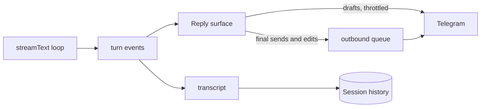

# Telegram replies

A turn that uses tools appears in Telegram as a **transcript**: streamed text
segments interleaved with one status message per tool call. It is delivered
through a *Reply surface*, so turns can also run against a test recorder
instead of a live bot.

## How it works

- **Text segments.** Each segment streams as a Rich Message draft with its own
  draft ID, then is sent as a finished Rich Message. Markdown goes directly
  through `rich_message.markdown`, so no MarkdownV2 escaping or splitting is
  needed.
- **Tool messages.** Each tool call gets one silent message, which is edited
  in place when the call succeeds or fails, for example
  `✅ web_search · cats · 5 results · 1.2s`.
- **Notifications.** A finished segment is held until the next event shows
  whether it is the final answer. Intermediate segments and tool messages are
  silent; only the final answer notifies. Messages stack without quote-reply
  anchors.
- **Ordering.** Persistent sends and edits go through the
  [outbound queue](../../src/features/agent/outbound-queue.ts), which keeps
  them in order and retries a bounded number of times on 429. Drafts are
  throttled and fire-and-forget.
- **History.** The flattened transcript (prose interleaved with tool-summary
  blockquotes) is saved so the model can recall what it did. Durations and
  raw tool payloads aren't saved.

### Tool labels and summaries

Built-in tools provide hooks in
[`tools/index.ts`](../../src/features/agent/tools/index.ts):

- A **label** describes the input: a search query, the hostname of a URL, a
  code language or a task description.
- A **summary** describes the result: `5 results`, `12000 chars`,
  `awaiting approval`.

The hooks read untrusted values and fail softly. MCP tools have no hooks, so
they show only a status and a duration.

### Failure cases

| Case | Behavior |
| --- | --- |
| Stream fails partway | The partial transcript is kept with an interruption marker |
| Tools ran but no text | Tool summaries are saved and an empty-reply notice is sent |
| Nothing produced | The notice is sent; nothing is written to history |
| Telegram rejects a send | Logged as a delivery error. History may still contain the message |

## Limits

| Limit | Value |
| --- | --- |
| Rich Message length | 32,768 characters (not split or truncated; kept in bounds by the model's output cap) |
| Plain `sendMessage` | 4,096 characters (email confirmations) |
| Draft update interval | 800 ms |
| Tool label/summary length | 100 characters |

## Design decisions

- **Rich Messages for drafts and final segments.** Formatting stays
  consistent while streaming, and the MarkdownV2 fallback code was removed
  ([ADR-0010](../adr/0010-rich-messages-for-the-streaming-reply.md)).
- **A delivery seam.** The adapter owns Telegram IDs, draft throttling,
  markup and persistent sends. Turn events carry content only
  ([ADR-0012](../adr/0012-reply-surface-delivery-seam.md)).
- **A multi-message transcript.** A single draft hides tool activity after it
  finishes and makes intermediate prose look like the answer
  ([ADR-0021](../adr/0021-transcript-reply-multi-message-agentic-turn.md)).
- **Input labels and elapsed time.** A result summary alone doesn't show what
  was asked for. Labels are saved to history; durations are display-only
  ([ADR-0026](../adr/0026-enriched-tool-line.md)).

## Source

- [`reply-surface.ts`](../../src/features/agent/reply-surface.ts),
  [`turn-events.ts`](../../src/features/agent/turn-events.ts),
  [`transcript.ts`](../../src/features/agent/transcript.ts),
  [`outbound-queue.ts`](../../src/features/agent/outbound-queue.ts),
  [`quote.ts`](../../src/features/agent/quote.ts)
- Tests: `reply-surface`, `turn-events`, `transcript`, `outbound-queue`,
  `quote` in [`src/tests/`](../../src/tests/)
