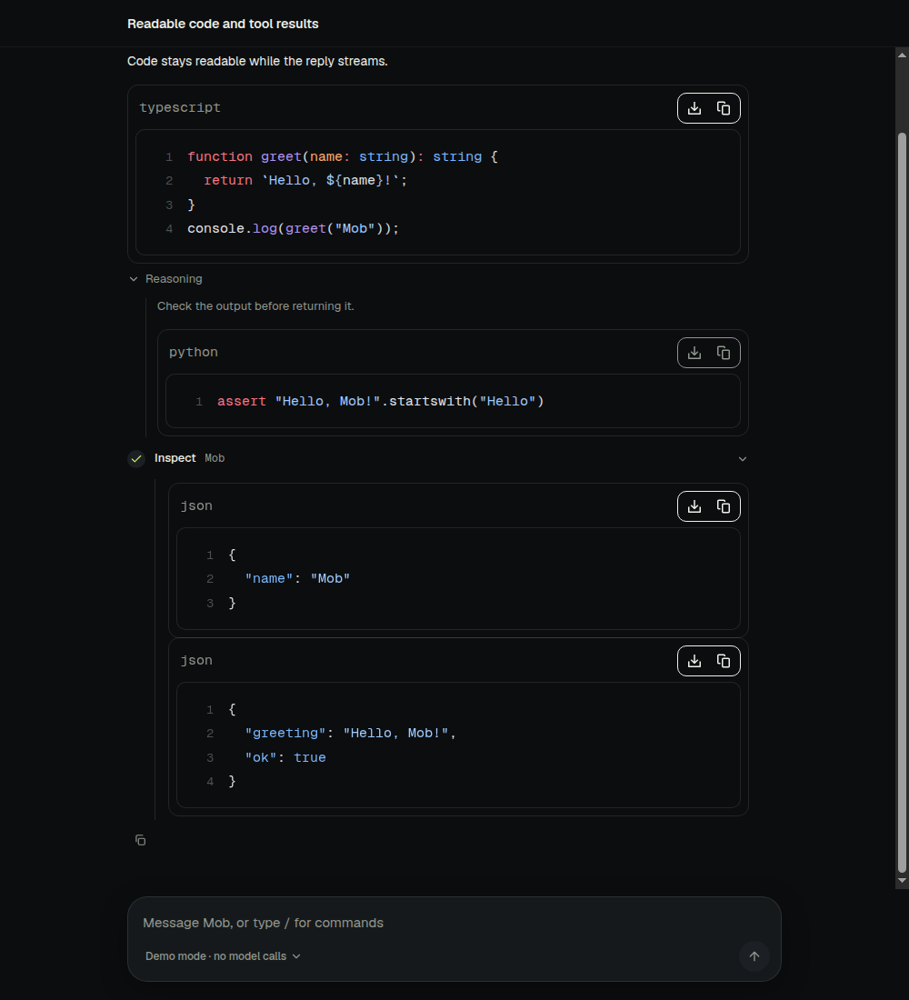

# Turns and context

A turn is one reply from the model, including every tool call it makes. This
page covers how a turn runs, how clients follow it, and what limits apply.

In short:

- A reply belongs to the service, not to the window that asked for it. Close
  the tab or lose the network and it keeps going; open the conversation again
  and it catches up. **Stop** ends it.
- Messages have no length limit of their own. A reply runs until it is done
  or reaches 20 tool steps (`max_tool_steps`, configurable); then **Continue**
  carries on.
- The ring beside Send shows how full the model's context is. When a long
  conversation no longer fits, Mob clears old tool outputs, then summarizes
  older messages; **Compact now** (`/compact`) summarizes at once.
- `/usage` and the **Token usage** page show what conversations cost.

The sections below give the details and where each lives in the code.

## Turns outlive their request

- `ConversationService.start` admits a turn and runs it on the service's own
  context. Closing the tab, reloading or losing the network does not end it.
  Only `POST /api/conversations/{id}/stop`, `close`, or replacing the access
  token that started it end it early. The token is checked at admission and
  watched after it, so a turn started with a replaced token does nothing, and a
  replacement also stops an approved call that runs before the turn's first
  event.
- Errors before the turn emits anything (busy, repeated request, stale approval,
  no model) are returned as HTTP errors. One turn runs per conversation; a
  competing send gets 409.
- Every admitted turn, including those channels start with `execute`, keeps a
  `Running` log of its events in memory. Events are numbered from 1 and
  written as SSE `id:` lines.
- `GET /api/chat/{id}/stream` replays the running turn from its first event, or
  from the event after `Last-Event-ID`, and then follows it live. It answers 204
  when no turn is running. Any number of clients can follow one turn, and a
  client that leaves ends only its own stream.
- `GET /api/conversations` marks each conversation `active` while a turn runs
  and `waiting` while a tool call awaits the owner's decision. A turn starting
  or ending, and an approval being requested, decided or expiring, publish a
  list change on `/api/events`, so the web sidebar marks those conversations as
  they change. Because the turn belongs to the service, the web workspace lets
  the owner switch conversations or open a page while a reply streams; only
  while a message, command or decision is still on its way to Mob
  (`dispatching` in the client state) does it hold the other conversations.
- The web workspace keeps unsent drafts separately for each conversation while
  switching between them. Drafts stay in memory until the workspace closes or
  disconnects; they are not written to browser storage. The workspace error
  banner's **Refresh** retries initialization and the requested conversation,
  then clears the error on recovery.
- A conversation starts with its first message. The web's New conversation
  opens a draft under an ID it chooses, in the form Mob gives conversations (32
  hex characters); `POST /api/chat` or a transcript command under that ID
  creates the conversation, and `GET /api/conversations/{id}` answers an empty
  snapshot until then. `GET /api/conversations` leaves out conversations nothing
  was said in, so a New conversation that is never used leaves nothing behind.
  `POST /api/conversations` still creates one at once, for the TUI.
- `POST /api/conversations/{id}/rename` with `{title}` gives a conversation a
  title of 1 to 200 characters. `POST /api/conversations/{id}/delete` deletes it
  with its messages, decisions, schedules and remembered approvals. It answers
  409 while a turn runs there, and for a coding agent's task conversation or one
  that started tasks, which stay with the agent tree. Facts the owner approved
  apply everywhere, so they outlive the conversation that saved them, and the
  usage ledger keeps the tokens it spent (Token usage lists it as a deleted
  conversation).
- A `POST /api/chat` request with `replace` set to the ID of an earlier
  message the owner sent says that message again: the message and everything
  after it are deleted, with decisions on the deleted replies, in the same
  transaction that records the new text, so a refused, repeated or stopped
  request deletes nothing. Facts, remembered approvals, schedules and
  the usage ledger stay. A compaction summary that covered a deleted message is
  dropped, and a title taken from the first message follows it when that is the
  one replaced. It answers 404 for a message that is not the owner's in that
  conversation, 400 for a slash command, and 409 while a turn runs or in a
  coding agent's conversation, whose agent keeps its own session. In the web, **Edit** on the owner's message
  sends its new text this way, and **Retry** on the last reply sends the
  message it answered again.
- The web UI and experimental TypeScript TUI use the same `@mob/client`
  conversation state and follow a running turn whenever a snapshot says one is
  active. The client reads the replay itself (`reconnectToStream` and
  `readUIMessageStream`) rather than through `resumeStream`, so every attempt
  builds the reply from fresh state and replaces the saved draft; one reconnect
  is in flight at a time, polling pauses until it ends, and a failed attempt
  waits for the next poll. Idle snapshots poll every two seconds. A snapshot
  requested before a local send or view detachment cannot overwrite newer
  state. Once an eligible result from a newer issued read has been published,
  neither an older success nor an older error can replace it. Successes and
  failures both advance this publication order. A later read that is merely
  pending does not block a completed result, so reads slower than the polling
  interval still update history and model rather than silently starving.
- `GET /api/events` streams what each store write changed as SSE `data:` lines
  (`{"seq","conversation","list","tasks"}`), with a heartbeat comment every 25
  seconds. It keeps no history: a client reloads what it shows each time the
  stream connects, and a subscriber more than 256 changes behind is dropped and
  reconnects. While it is live, the web UI reloads a conversation, the list or
  the agent tree only when they changed, instead of polling; a two-second tick
  only retries a reload that had to wait for a stream to end. When the stream is
  down, or the service predates it (404), polling resumes. Hidden pages skip
  polling and reload when shown again.
- A pending approval expires when its hour passes, on a timer the store arms
  for each conversation's earliest pending approval (and again on start), so
  clients following changes see the expiry without asking for a snapshot.
  Successful snapshot reconciliation clears transient polling/follow errors,
  but does not dismiss a failed command or approval decision.
- A retained shared-client instance keeps uncertain send text and its original
  SDK-generated request ID across detach/start. Abort alone does not mean the service
  refused the request. The client stays busy until the local send settles and
  fresh history can be checked for that exact user-message ID, never by text.
  While history cannot be read (the service is unreachable), it stays busy but
  returns the original to an empty, unedited editor so the text is not lost.
  If found, it follows the accepted turn or shows completed history. If absent,
  it exposes `recovery: {requestId, text}` and a delivery-not-confirmed warning;
  it restores the editor only if no newer draft edit exists, even if the newer
  editor is now empty. It never automatically resends or replaces the ID.
  Later history can confirm that ID and clear recovery; a restored editor is
  cleared only if it has not been edited since. A manual Send is a new request,
  not a delivery guarantee for the uncertain original. Recovery is memory-only.
- Leaving a shared-client view cancels only that view's streams and polling;
  explicit Stop posts to the service and cancels the local readers. The source
  entry (`bun run tui:pilot`) only attaches to an existing service. `mob tui`
  starts the background service when none runs, and leaves it and its turns
  running when the terminal exits.
- The reply is saved about once a second while it streams, so a forced
  termination can lose the last second. The event log is not persisted: the
  saved message is the result once a turn ends, and a service restart marks
  turns in progress interrupted rather than rerunning them.

## Code and structured content

The browser and desktop conversation views share a Streamdown renderer for
message text, command results and expandable reasoning. Fenced code blocks use
Shiki through `@streamdown/code`, with language grammars loaded from the app's
own assets as needed. Highlighting runs locally, follows the app's light/dark
scheme and does not execute the displayed code. Missing or unknown languages
remain readable as plain text; inline code keeps its monospace styling.

Code remains visible while highlighting loads and while a reply streams, even
before its closing fence arrives. Streamdown owns incremental rendering and the
plugin's bounded token cache. Tool inputs and outputs are serialized as JSON
and displayed as static code blocks, so embedded Markdown or HTML remains data.
Tool JSON above 20,000 UTF-16 code units or 300 lines bypasses Markdown parsing
and highlighting to avoid blocking the UI, including when tool details are
collapsed. It remains complete, escaped plain text in a keyboard-focusable,
scrollable container. Both highlighted blocks and plain tool JSON retain copy
controls.

The shared rendering configuration is in
`packages/app/src/ai-elements/message.tsx`; the conversation uses it in
`packages/app/src/Thread.tsx`.

## Limits follow the model

- **Messages.** A chat message has no length limit of its own. The chat request
  body is capped at 8 MiB only to stop runaway bodies, and neither the web
  composer nor the terminal input limits what is typed or pasted. A message that
  alone exceeds what the model's context leaves room for ends the turn with an
  error naming its size and the model, before any model request.
- **Terminal pastes.** The terminal UI takes a bracketed paste into its native
  textarea whole, without treating its newlines as send keys.
- **Replies.** A reply may use the model's output limit, up to 32000 tokens and
  at most a quarter of its context window. Without a known limit, the
  OpenAI-compatible driver lets the provider choose and the Anthropic driver
  asks for 32000; history still leaves room for a 32000-token reply. Anthropic
  thinking comes out of those reserved tokens, at most half of them; a reply
  under 2048 tokens has no thinking, as Anthropic requires at least 1024.
- **Time.** A turn has no deadline. It ends when it finishes, when it is
  stopped, or when it reaches the tool step limit (`max_tool_steps`, default
  20, at most 100, reloaded live). A reply that reaches the limit is saved with
  status `step-limit` and its stream ends as finished (`tool-calls`), not as
  an error. The web UI offers a Continue button under it that sends
  "Continue" without clearing or sending an existing editor draft; channels
  show the limit, and any message continues. A model request fails
  with "model stopped responding" when its response does not start, or stops
  arriving, for two minutes; a reply that keeps arriving is never cut off.
- **Retries.** A model request that fails before its response begins, from a
  dropped connection or with HTTP 408, 429, 500, 502, 503, 504 or 529
  (overloaded), is sent again up to three times, waiting one, two, then four
  seconds, or as long as the provider's `Retry-After` asks, at most a minute.
  A 429 for an exhausted quota (`insufficient_quota`), a stalled request and
  a response already streaming are not retried, so a retry never repeats text
  the turn has shown. The code is in `packages/core/src/llm/send.ts`.
- **Tool arguments** may be up to 1 MiB.

## Counting the context

- A prompt may use the model's context window less the reply's reserve. The
  system prompt, the tool definitions and history count against it, as do the
  notice that history was cut and the note an approved call continues with.
- At the start of a turn, history is fitted to that budget from an estimate of
  about three bytes a token. When the model's window is unknown, the last 40
  messages are kept. Older history remains visible in the UI.
- When history does not fit, old tool outputs are cleared first (below), then
  older messages are summarized (below); only when that fails are whole turns
  omitted, oldest first.
- Within a turn, the prompt's size is what the provider reported for the last
  step, its input and output, plus an estimate of the tool results added since.
  Without a report, every added message is estimated.
- Before each further step, a prompt over budget first clears outputs the
  model has already read. If that is not enough, the turn ends with an error
  naming the model and the size, and asks the user to send another message,
  whose turn fits history to the window again.
- Providers count tokens their own way and can refuse a prompt the estimate let
  through. Drivers mark that refusal (`OverflowError`), and the turn
  then frees about a quarter of the prompt once and asks again: before the
  model has replied, by fitting history to less; after, by clearing outputs the
  model has already read, never those of the step just run. A second refusal,
  or nothing to free, ends the turn and suggests `/compact`.

## Showing the context

- The web composer shows, beside Send, how much of what a turn can send the
  conversation's prompt takes: a ring and a percentage of the limit (the
  window less the reply's reserve, where history starts to be summarized),
  grey until 75%, amber from 75% and red from 90%. On a phone it shows the
  ring alone. A model whose window is unknown shows its tokens only.
- Opening it shows what the prompt holds: instructions and tool definitions,
  the summary of earlier messages, messages, tool outputs, the free room and
  the reply's reserve; how many earlier messages are read as a summary;
  **Compact now** (`/compact`); and the conversation's total tokens and cost,
  which lead to the Token usage page.
- While a turn runs, the engine reports a `ContextSnapshot` as a `data-context`
  stream part (id `context`, replaced as it goes): estimated once history is
  fitted, then after each step from the provider's count, its parts scaled to
  that count. `GET /api/conversations/{id}/context` returns the last turn's
  report while its reply is the latest message and the model is unchanged;
  otherwise it estimates the next turn's prompt without calling the model,
  writing no summary and running no hook besides saved facts, so history the
  window cannot hold shows as more than 100%. It also returns the
  conversation's `UsageSummary`.
- A coding agent's conversation shows what the agent reports over ACP
  (`usage_update` `used` and `size`), without parts or Compact now.

## Clearing old tool outputs

- Tool outputs are replaced, oldest first, with a short note naming the tool
  and the size of what was cleared. The note gives the saved file's path when
  there is one, so the model can read it again; otherwise it says to run the
  tool again.
- When history is fitted, the latest turn keeps its outputs. Within a turn,
  outputs from the step just run are never cleared, and once the provider has
  counted the prompt only outputs whose size was measured from its usage are
  cleared, so clearing never claims more room than it frees.
- Outputs smaller than about twice their note are left as they are. Stored
  messages keep every output; clearing changes only what the model reads.
- Clearing changes the prompt's prefix, so the provider's prompt cache misses
  once after each clearing. The code is in `packages/core/src/chat/prune.ts`.

## Prompt caching

- OpenAI-compatible providers cache a repeated prompt prefix on their own. The
  Anthropic driver marks the end of the tool definitions, the end of the
  system prompt and the last block of the latest message with
  `cache_control` (`ephemeral`, five minutes), so each step of a turn, and the
  next turn sent within five minutes, reads the prefix the previous request
  wrote. Compatible vendors that cache on their own ignore the marks.
- The system prompt and tool definitions come before the messages, so
  anything that changes them misses the cache once: a tool `tool_search`
  loads, a new summary, a newly saved fact, clearing an old tool output.
  Prompts shorter than the model's minimum (about 1024 tokens) are not cached.
- Cache reads and writes are reported in usage and priced from the catalog.

## Tool arguments

- Built-in tools declare their arguments with a zod schema, and the model is
  offered that schema as JSON Schema. The skill, Cloudflare and `tool_install`
  tools still declare JSON Schema by hand and are not checked yet.
- Before a tool runs, the turn parses the model's arguments against it.
  Arguments that do not match never reach the tool: the call fails with an
  error naming each wrong field, which the model reads and can retry from.
- Fields the schema does not declare are dropped, so a tool receives only
  what it declared.
- Tools without a zod schema, such as MCP server tools, receive their
  arguments as the model wrote them, as before; the server checks them.

## Large tool output

- Tools return their whole result. Sandbox commands keep up to 1 MiB of each
  stream, and network reads keep their own size limits as a defence.
- The turn decides what the model reads. An output up to 24000 bytes of JSON,
  about 8000 tokens, is read whole.
- A larger output is shown as its head (two thirds) and tail (one third), with
  its size and a note. With a sandbox, the whole output is first saved as text
  in the conversation's workspace under `/workspace/.mob/outputs/`, the preview
  shrinks to 4000 bytes, and the note tells the model to read the rest with the
  sandbox tool. Without one, the preview uses the whole 24000 bytes. The budget
  counts the preview as the model receives it, escaping and note included.
- Each saved output gets a new file name, as call IDs repeat across turns. The
  save resolves every step of its path inside the workspace and never replaces
  an existing file, since commands can plant symlinks there.
- The stored message keeps the whole output and where it was saved, so the
  interface shows it all and later turns read the same preview. Approved calls
  follow the same policy.

## Summarizing older history

- The summary prompt requests four sections: goal and constraints, decisions
  and evidence, progress and verification, and remaining work. Empty sections
  are omitted and headings follow the conversation's language. It preserves
  acceptance criteria, relevant rejected approaches, denied or revoked
  permissions, important paths and task IDs, and instructions to reload.
  Hypotheses remain unverified; attempted actions are not reported as success.
- A summary is historical data, not new instructions or permission. Current
  user corrections and the runtime's tool approval state take precedence.
  The summarizer is instructed to ignore instructions embedded in external
  data and replace superseded requests. This guides the model; summaries are
  still lossy and do not replace stored approval decisions.
- When history does not fit after clearing, the conversation's model folds the
  older messages into the conversation's summary, stored with the ID of the
  last message it covers. Turns read the summary in the system prompt in place
  of those messages.
- The summary covers enough that the recent messages fill at most half the room
  beside it, so the next turns need not summarize again. It is written in parts
  that fit the model's window, each part refitted as the summary grows, and is
  at most 4000 tokens and no more than the latest message leaves room for.
- A stored summary is read whenever it fits beside the latest message. One that
  does not, as after switching to a model with a smaller window, is set aside
  for the turn, which reads the messages it covers instead. With an unknown
  window it is always read.
- When an approval is decided or expires, the call's stored message changes; a
  summary that covers it is dropped, and the next turn reads the call as it is.
- A failed summary, or one that comes out too long, is not used: the turn omits
  the older messages instead.
- A summary is lossy, so a turn that reads earlier messages only as a summary,
  or omits them, also offers `history_search`. It ranks excerpts of those
  messages (text, and tool calls with their results, about 1500 characters
  each, overlapping on long parts) by BM25 against keywords or a message ID,
  and returns up to 15 in their original words, marked as historical data.
  Nothing is indexed ahead of time: it reads the stored history the turn
  already loaded, so deleted messages are never found. The code is in
  `packages/core/src/chat/history.ts`.
- `/compact` summarizes every message since the summary on request, with the
  conversation's model, and records what that cost on its reply, also when it
  is stopped. The code is in
  `packages/core/src/chat/compact.ts`.

## Token usage

- Each model request records what it used in the `usage` table: the
  conversation, the reply, the model (`provider/model`), input (every prompt
  token, cached or not), output (reasoning included), reasoning, cache reads
  and writes, the cost priced from the catalog, and how long the request took.
  Summarizing, in a turn or by `/compact`, is recorded the same way, one row
  for each request when a summary is written in parts. Replies
  saved before 2026-10-20 were counted from the usage saved on them, one
  request each, with no duration. The reply's own usage (the `data-usage`
  stream events and its `usage` metadata) is unchanged. Since schema 13 each
  row also has `first_token_ms`, from the request's start to its first text or
  reasoning (0 when none came, such as a request that only called tools).
- Each reply records its model, usage and `stats` (`messages.stats`, schema
  13): `startedAt` and `finishedAt`; `firstTokenMs`, from the start of the
  turn to the first words of the reply; `generationMs`, each request's time
  from its first words to its end, added up, with `timedOutput`, the output
  tokens of those requests, so `timedOutput / generationMs` is how fast the
  model writes; `toolMs`, the time tools ran; and `requests`. The requests
  that summarize older messages before the reply, and a prompt sent again
  after the provider refused it as too long, count among them. A coding agent's reply records
  only `startedAt`, `firstTokenMs` and `finishedAt`, since its own requests are
  not visible. The history returns them in each reply's metadata (`model`,
  `usage`, `stats`). The stream's `start` chunk carries the reply's model, and a
  `message-metadata` chunk at its end carries its model, usage and stats, so a
  client shows the same thing during and after the reply. The web shows, under
  each reply, its model, its tokens (input and output) and how fast the model
  wrote; while the reply is written, its model only. The TUI writes the same
  under each finished reply in one line, with its time. Clicking it in the web opens what the
  reply used (input, output, speed, cache, reasoning, requests, time, cost) and
  where its time went: writing, tools and the rest, with the wait for its first words beside them. A coding
  agent's reply shows its time instead of a speed. Replies saved before
  schema 13 have no stats. Exports carry stats and first-token times; older
  exports without them still import.
- `/usage`, in every client and channel, shows what the conversation used by
  model: input, cache reads and writes, output, reasoning, requests and cost,
  then the total, the share of input read from the cache, the number of
  replies and how long the models worked. Cost is the provider's list price;
  a subscription is not charged it.
- The web workspace's **Token usage** page (`GET /api/usage?days=7|30|0`,
  `store.report`) shows the last 7 days, 30 days or all time: total tokens,
  the share of input read from the cache, cost and model time; a bar of where
  the tokens went (fresh input, cache reads, cache writes, output); tokens per
  day on the service's calendar stacked the same way, with each day's numbers on hover; tokens,
  cache share, output, requests and cost by model; and the 20 conversations
  and tasks that used the most, each opening its conversation. Replies
  counted from before the table existed are dated to their conversation's
  last update.
- `store.conversationUsage(ids)` returns the same summaries
  (`UsageSummary`) for other features. The code is in
  `packages/core/src/chat/usage.ts`.

