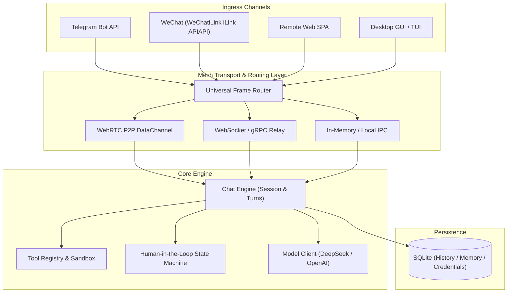
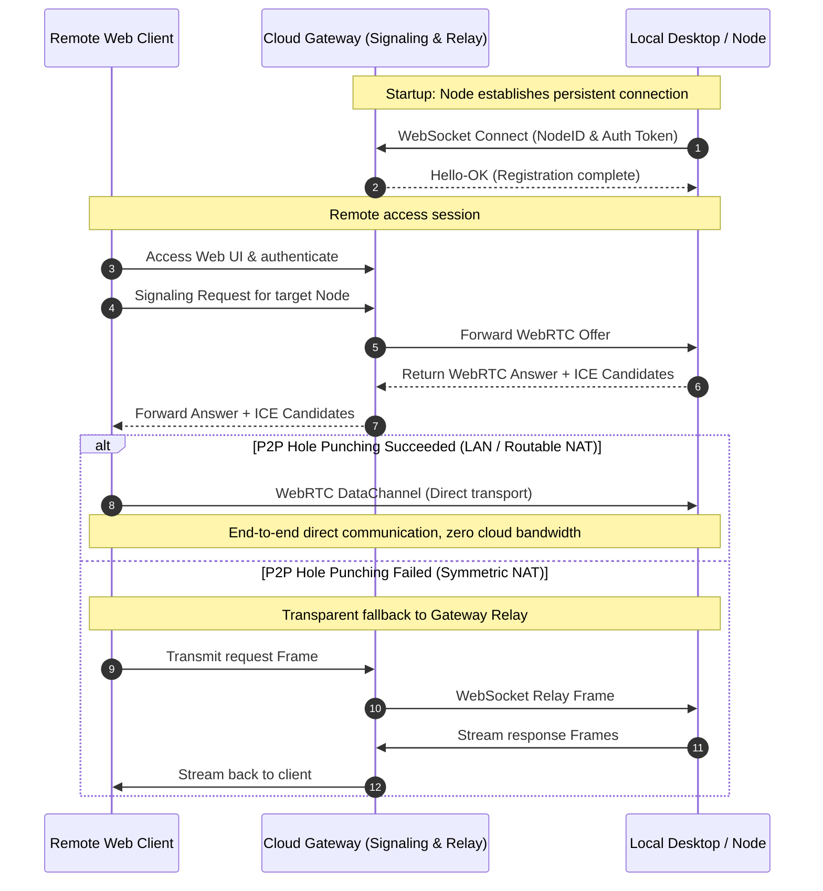
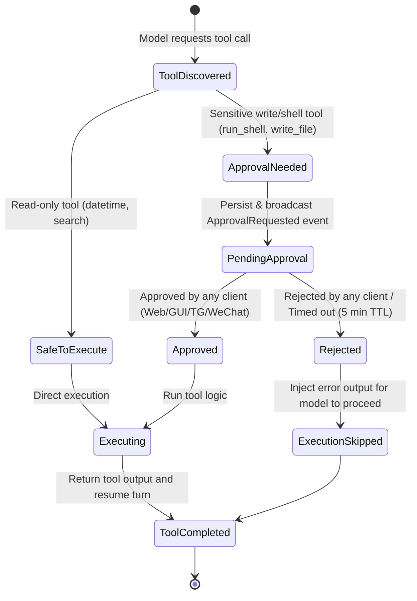

# Mob Product Architecture & Technical Specification

> **Version**: v1.1.0  
> **Status**: Approved & Implemented  
> **Updated**: 2026-10-11  
> **Scope**: Cross-platform unified architecture, mesh topology, channel ingress, and product specifications

---

## 1. Product Vision & Value Proposition

### 1.1 Vision
**Mob** is a **local-first, cross-device mesh, omnichannel** personal AI agent assistant.

Traditional AI assistants force a trade-off between:
- **Cloud-only SaaS**: Sacrifices privacy; cannot access local files, Shell environments, or private device tools.
- **Local-only Desktop Apps**: Isolated to a single computer; cannot be reached from mobile browsers or messaging apps while away.

Mob bridges this divide across a **single, unified codebase**:
1. **Desktop App**: Possesses full local compute, SQLite persistence, local file system, and shell execution capabilities.
2. **Cloud Gateway**: Acts as a lightweight, headless relay hub, providing public relaying, Web SPA hosting, WebRTC signaling, and IM channel integrations.
3. **Remote Web / Mobile**: Enables secure remote access to the home agent anytime via browser, preferring peer-to-peer (P2P) connections.

### 1.2 Core Architectural Principles
* **Local-First & Privacy**: Chat history, memory, and sensitive credentials reside in local SQLite by default, not uploaded to centralized databases.
* **Single Codebase**: Go backend core + React/Bun frontend, supporting Desktop, Cloud Gateway, and Edge Node via flags and subcommands.
* **Hybrid Mesh Connectivity**: Prefers direct WebRTC P2P DataChannels on local or routable networks; falls back seamlessly to encrypted Gateway WebSocket relays when behind symmetric NATs.
* **Omnichannel Consistency**: Telegram, WeChat (WeChat iLink), Web, and Desktop share unified session contexts, tool definitions, and human-in-the-loop approvals.

---

## 2. User Personas & Core Scenarios

### Scenario A: Local Deep Task Execution (Desktop Mode)
- **Action**: User opens Mob desktop application (Wails GUI or Bubble Tea TUI) on macOS, Linux, or Windows.
- **Capabilities**: The agent directly reads local repository code, executes CLI scripts, and manages local schedules. For sensitive operations (e.g., file writes, shell execution), the UI presents a human approval card.

### Scenario B: Remote Mobile Access via P2P / Relay
- **Action**: User leaves home and accesses their home computer's Mob instance via mobile browser.
- **Flow**:
  1. User navigates to the Web SPA hosted by the Cloud Gateway and authenticates with a Token.
  2. The Gateway coordinates WebRTC signaling (Offer / Answer / ICE Candidates) between the browser and the home desktop node.
  3. If hole-punching succeeds, traffic flows directly over an encrypted WebRTC DataChannel (zero cloud bandwidth).
  4. If hole-punching fails, traffic seamlessly routes through the Gateway's bidirectional WebSocket relay without stream disruption.

### Scenario C: Instant Messaging Ingress (Telegram & WeChat iLink)
- **Action**: Interacting with Mob directly via existing instant messaging apps.
- **Channels**:
  - **Telegram**: Communicates via Telegram Bot API with Markdown rendering and Inline Keyboard approvals.
  - **WeChat (WeChat iLink)**: Directly integrates with Tencent's official WeChat iLink HTTP API (`ilinkai.weixin.qq.com`), supporting QR-code scan authorization, HTTP long-polling message receipt, context-bound replies, and in-band approval commands.

---

## 3. System Architecture & Runtimes

The system employs a microkernel architecture with layered abstractions:

### 3.1 Runtime Formats & Roles

| Runtime Role | Command | Key Components | Deployment Target |
| :--- | :--- | :--- | :--- |
| **Desktop App** | `./build/mob desktop` | Wails GUI + Webview + Local Core Engine + SQLite | Personal workstation (macOS/Win/Linux) |
| **Terminal TUI** | `./build/mob tui` | Bubble Tea + Lip Gloss + Local Core Engine | Terminal environment / SSH session |
| **Cloud Gateway**| `./build/mob gateway` | Headless Daemon + Web SPA Server + Signaling Hub + IM Ingress | Cloud VPS / Container |
| **Agent Node**   | `./build/mob serve --connect-gateway <url>` | Headless execution engine reverse-connected to Gateway | Workstation / NAS / Homelab |

---

## 4. Connectivity & Mesh Networking

### 4.1 Hybrid Connectivity Model

### 4.2 WebRTC & Security Policies
1. **P2P Transport Protocol**: Utilizes WebRTC DataChannel with built-in DTLS-SRTP encryption for native end-to-end transport confidentiality.
2. **Liveness & Failover**: Heartbeat probes (Ping/Pong) detect DataChannel drops within 1.5 seconds and trigger automatic fallback to the Gateway relay without stream disruption.

---

## 5. Channel Integration Specifications

### 5.1 Telegram Channel
- **Modes**: Supports Webhook mode (public Gateway deployment) and Long-polling (local deployment).
- **Behavior**:
  - Streams text updates throttled to 500ms intervals to prevent rate limiting.
  - Renders tool approvals via Telegram Inline Keyboards ("✅ Approve", "❌ Reject").

### 5.2 微信 WeChat iLink 渠道接入
- **协议依据**：腾讯微信团队官方公布的 **iLink Bot HTTP API 协议**（服务接入点 `https://ilinkai.weixin.qq.com`）。
- **接入架构与机制**：
  1. **免 Node/插件独立运行**：由 Mob 原生 Go 模块（[`internal/plugins/wechatilink`](file:///Users/fdkevin/Workspace/mob/internal/plugins/wechatilink)）直接实现客户端协议，无需本地安装外部 Node/OpenClaw 运行时。
  2. **扫码登录流程**：
     - 调用 `POST /ilink/bot/get_bot_qrcode` 获取二维码内容与唯一标识。
     - Web UI / 桌面端提供一键获取二维码面板，用户使用手机微信扫码授权。
     - 轮询 `GET /ilink/bot/get_qrcode_status` 检测状态，确认授权后自动将 `bot_token` 与 `ilink_bot_id` 本地持久化。
  3. **消息长轮询接收**：
     - 调用 `POST /ilink/bot/getupdates`，携带 `get_updates_buf` 游标实现增量消息长轮询与去重。
  4. **关联上下文回复**：
     - 调用 `POST /ilink/bot/sendmessage`，带上收信时腾讯下发的 `context_token`，将 Agent 生成的回答回复给微信用户。
  5. **带内工具审批 (In-Band Tool Approval)**：
     - 当 Agent 触发敏感工具时，微信端下发审批提醒：`⚠️ 审批提醒: [工具名] (ID: [审批ID])`。
     - 微信用户回复 `批准 [审批ID]` 或 `拒绝 [审批ID]`，驱动 Engine 完成决策。
### 5.2 WeChat iLink Channel
- **Protocol**: Built against Tencent's official **iLink Bot HTTP API** (`ilinkai.weixin.qq.com`).
- **Implementation**:
  1. **Pure Go Implementation**: Natively implemented in [`internal/plugins/wechatilink`](file:///Users/fdkevin/Workspace/mob/internal/plugins/wechatilink), without requiring external Node.js/OpenClaw runtimes.
  2. **QR Code Login Flow**:
     - Calls `POST /ilink/bot/get_bot_qrcode` to retrieve QR code image and token.
     - The Web and Desktop settings UI renders the QR code for mobile WeChat scanning.
     - Polls `GET /ilink/bot/get_qrcode_status` until confirmed, storing `bot_token` and `ilink_bot_id` locally.
  3. **Message Ingress**:
     - Long-polls `POST /ilink/bot/getupdates` using the `get_updates_buf` sync cursor.
  4. **Context-Bound Reply**:
     - Sends replies via `POST /ilink/bot/sendmessage` bound to the incoming `context_token`.
  5. **In-Band Tool Approvals**:
     - When a sensitive tool is called, the bot sends an approval prompt to the user's WeChat.
     - The user replies with `批准 [ID]` or `拒绝 [ID]` to make a decision.

---

## 6. Human-in-the-Loop Approval State Machine

To ensure safety during command execution, a unified 3-tier permission model is enforced:

---

## 7. Persistence & State Synchronization

1. **Storage Design**:
   - SQLite as the embedded database for zero external dependencies.
   - Core tables: `conversations`, `messages`, `approvals`, `credentials`, `settings`.
2. **Synchronization Strategy**:
   - **Edge-First**: The desktop/edge node acts as the primary data owner; conversations are written to local SQLite.
   - **Lightweight Gateway View**: The Cloud Gateway maintains active connections and routing tables without storing private chat history.

---

## 8. Milestones & Delivery Status

| 阶段 | 目标里程碑 | 交付物 | 状态 |
| :--- | :--- | :--- | :--- |
| **M1: 核心解耦与协议统一** | 抽象 Engine 接口，统一跨端数据帧定义 | Go Mesh Frame 协议，`contracts.ts` 契约升级 | **已完成** |
| **M2: 云端 Gateway 与中继网格** | 支持 `mob gateway` 子命令，实现节点长连接与远程 Web 中继 | WebSocket 双向中继代理，远程 Web 访问鉴权 | **已完成** |
| **M3: WeChat iLink 与 Telegram** | 基于腾讯官方 iLink 协议直接实现微信扫码授权、长轮询与带内审批 | 原生 Go `wechatilink` 模块，Web 扫码登录组件 | **已完成** |
| **M4: P2P 直连与网络穿透** | 基于 WebRTC 实现浏览器与桌面端点对点直连 | Pion WebRTC 数据通道，Gateway ICE 信令服务 | **规划中** |
| Milestone | Target | Deliverable | Status |
| :--- | :--- | :--- | :--- |
| **M1: Core Decoupling & Protocol** | Abstract Engine interfaces, unified mesh frame protocol | Go Mesh Frame Protocol, `contracts.ts` update | **Completed** |
| **M2: Cloud Gateway & Relay Mesh** | Implement `mob gateway`, node reverse-relay & Web hosting | WebSocket bidirectional relay, remote Web access | **Completed** |
| **M3: WeChat iLink & Telegram Ingress** | Native Go WeChat iLink client, QR-code login, in-band approvals | Pure Go `wechatilink` module, UI QR scan component | **Completed** |
| **M4: WebRTC P2P Direct Tunnel** | WebRTC DataChannel hole-punching for browser-to-node direct access | Pion WebRTC channel, ICE signaling exchange | **In Progress** |
