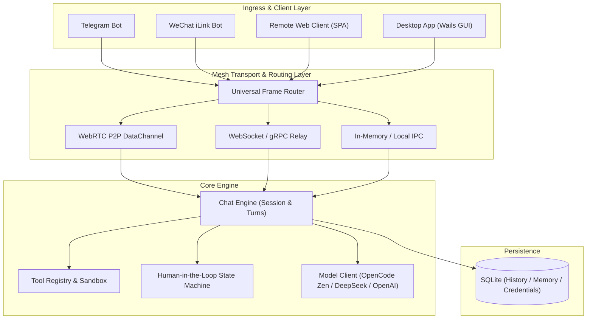
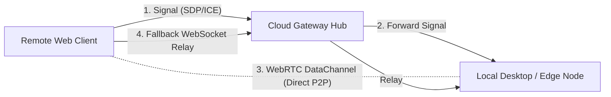
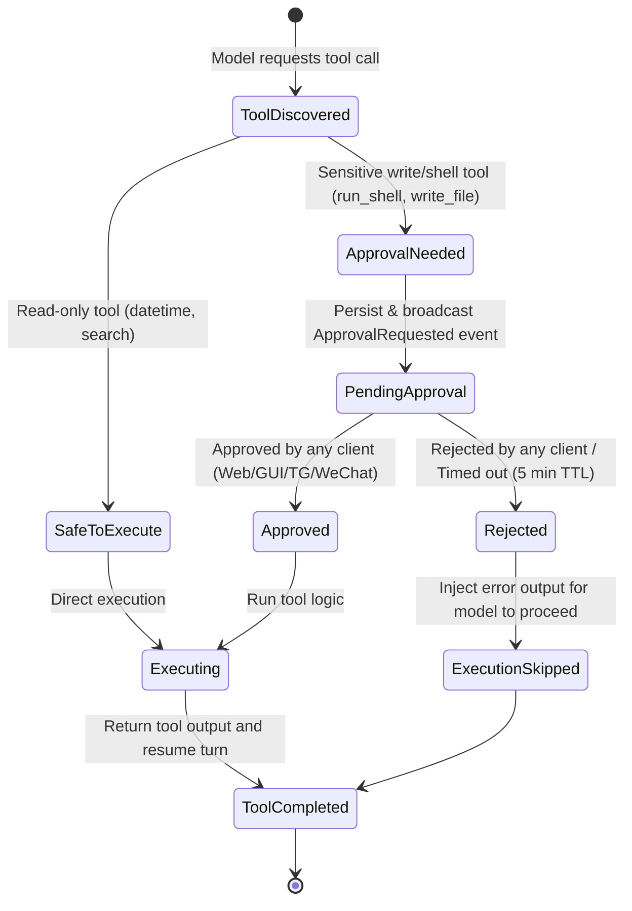

# Mob Multi-Runtime Architecture & Product Specification

- **Version**: 1.2.0
- **Status**: Active / In Progress
- **Authors**: Mob Engineering Core

---

## 1. Executive Summary & Vision

Mob is evolving from a standalone personal assistant into a **unified multi-runtime AI operating mesh**. The system must run across diverse form factors—from personal desktop workstations (Wails GUI), headless edge daemons, and terminal interfaces (TUI), to cloud relay gateways and remote Web clients—sharing a single consolidated codebase.

### Key Objectives
1. **Single Unified Codebase**: A single Go core application providing the execution engine, local persistence, channel plugins, and desktop GUI wrapper, complemented by a React SPA frontend.
2. **Flexible Deployment Topology**: Any instance can act as a local desktop application, an edge node (e.g. on a home server/workstation), or a cloud relay gateway hosting the Web client.
3. **Hybrid Connectivity**: Direct browser-to-node WebRTC peer-to-peer (P2P) connections where network conditions permit, with seamless automatic fallback to cloud gateway WebSocket relays.
4. **Omni-Channel IM Ingress**: Seamless chat access via Telegram Bot and native WeChat iLink, with in-band tool approval state machines.
5. **Zero-Config Default Free AI**: Works out-of-the-box using the OpenCode Zen Free tier with the anonymous public token, with zero mandatory API key setup, while allowing seamless switching to custom providers (DeepSeek, OpenAI, Ollama, Cloudflare Workers AI).

---

## 2. System Architecture

### 3.1 Runtime Formats & Roles

| Runtime Role | Command | Key Components | Deployment Target |
| :--- | :--- | :--- | :--- |
| **Desktop App** | `./build/mob desktop` | Wails GUI + Webview + Local Core Engine + SQLite | Personal workstation (macOS/Win/Linux) |
| **Terminal TUI** | `./build/mob tui` | Bubble Tea + Lip Gloss + Local Core Engine | Terminal environment / SSH session |
| **Cloud Gateway**| `./build/mob gateway` | Headless Daemon + Web SPA Server + Signaling Hub + IM Ingress | Cloud VPS / Container |
| **Agent Node**   | `./build/mob serve --connect-gateway <url>` | Headless execution engine reverse-connected to Gateway | Workstation / NAS / Homelab |

---

## 4. Connectivity & Mesh Networking

### 4.1 Hybrid Connection Topology

1. **Direct P2P (WebRTC DataChannel)**:
   - Primary path for remote Web clients to connect to edge desktop nodes.
   - Hole punching negotiated via the Gateway's signaling endpoint (`/api/gateway/signal`).
   - Near-zero latency with end-to-end encryption.
2. **Gateway Relay (WebSocket Mesh Frame Protocol)**:
   - Fallback path for Symmetric NAT or firewall environments where direct ICE fails.
   - Bidirectional multiplexed frame transmission via universal `protocol.MeshFrame`.

### 4.2 Security & Authentication
1. **P2P Transport Protocol**: Utilizes WebRTC DataChannel with built-in DTLS-SRTP encryption for native end-to-end transport confidentiality.
2. **Liveness & Failover**: Heartbeat probes (Ping/Pong) detect DataChannel drops within 1.5 seconds and trigger automatic fallback to the Gateway relay without stream disruption.

---

## 5. Channel Integration Specifications

### 5.1 Telegram Channel
- **Modes**: Supports Webhook mode (public Gateway deployment) and Long-polling (local deployment).
- **Behavior**:
  - Streams text updates throttled to 500ms intervals to prevent rate limiting.
  - Renders tool approvals via Telegram Inline Keyboards ("✅ Approve", "❌ Reject").

### 5.2 WeChat iLink Channel
- **Protocol**: Built against Tencent's official **iLink Bot HTTP API** (`ilinkai.weixin.qq.com`).
- **Implementation**:
  1. **Pure Go Implementation**: Natively implemented in [`internal/plugins/wechatilink`](file:///Users/fdkevin/Workspace/mob/internal/plugins/wechatilink), without requiring external Node.js/OpenClaw runtimes.
  2. **QR Code Login Flow**:
     - Calls `POST /ilink/bot/get_bot_qrcode` to retrieve QR code image and token.
     - The Web and Desktop settings UI renders the QR code for mobile WeChat scanning.
     - Polls `GET /ilink/bot/get_qrcode_status` until confirmed, storing `bot_token` and `ilink_bot_id` locally.
  3. **Message Ingress**:
     - Long-polls `POST /ilink/bot/getupdates` using the `get_updates_buf` sync cursor.
  4. **Context-Bound Reply**:
     - Sends replies via `POST /ilink/bot/sendmessage` bound to the incoming `context_token`.
  5. **In-Band Tool Approvals**:
     - When a sensitive tool is called, the bot sends an approval prompt to the user's WeChat.
     - The user replies with `批准 [ID]` or `拒绝 [ID]` to make a decision.

---

## 6. Human-in-the-Loop Approval State Machine

To ensure safety during command execution, a unified 3-tier permission model is enforced:

---

## 7. Model Providers & Zero-Config Free Tier

Mob provides a zero-configuration out-of-the-box chat experience, while maintaining full flexibility for custom model providers:

1. **Default Free Tier (OpenCode Zen Free)**:
   - **Endpoint**: `https://opencode.ai/zen/v1`
   - **Default Model**: `mimo-v2.6-flash-free`
   - **Default API Key**: `public`, applied only after checking for a saved key for the Zen origin; explicit empty file keys disable setup.
   - **Verification Emulation**: Mob injects official client signatures (`User-Agent: opencode/1.18.34`, `x-opencode-*` headers, session/request IDs, and required tool declarations) to satisfy upstream anti-abuse requirements and prevent `FreeTierError`.
2. **Custom Providers**:
   - Users select provider endpoints and models via CLI flags, environment variables, or configuration file (`config.yaml`). Web/GUI setup can save a key for that provider unless the key is managed by runtime configuration.
   - **DeepSeek**: `https://api.deepseek.com` (`deepseek-chat`, `deepseek-reasoner`)
   - **OpenAI / Compatible**: `https://api.openai.com/v1` (`gpt-4o`, `gpt-4o-mini`)
   - **Local Ollama / vLLM**: `http://localhost:11434/v1`
   - **Cloudflare Workers AI**: Built-in plugin supports Workers AI models.

---

## 8. Persistence & State Synchronization

1. **Storage Design**:
   - SQLite as the embedded database for zero external dependencies.
   - Core tables: `conversations`, `messages`, `approvals`, `credentials`, `settings`.
2. **Synchronization Strategy**:
   - **Edge-First**: The desktop/edge node acts as the primary data owner; conversations are written to local SQLite.
   - **Lightweight Gateway View**: The Cloud Gateway maintains active connections and routing tables without storing private chat history.

---

## 9. Milestones & Delivery Status

| Milestone | Target | Deliverable | Status |
| :--- | :--- | :--- | :--- |
| **M1: Core Decoupling & Protocol** | Abstract Engine interfaces, unified mesh frame protocol | Go Mesh Frame Protocol, `contracts.ts` update | **Completed** |
| **M2: Cloud Gateway & Relay Mesh** | Implement `mob gateway`, node reverse-relay & Web hosting | WebSocket bidirectional relay, remote Web access | **Completed** |
| **M3: WeChat iLink & Telegram Ingress** | Native Go WeChat iLink client, QR-code login, in-band approvals | Pure Go `wechatilink` module, UI QR scan component | **Completed** |
| **M4: Default Free Model & Zero-Config** | Integrate OpenCode Zen Free tier with public key and client verification | `internal/chat/opencode.go`, default configurations | **Completed** |
| **M5: WebRTC P2P Direct Tunnel** | WebRTC DataChannel hole-punching for browser-to-node direct access | Pion WebRTC channel, ICE signaling exchange | **In Progress** |
